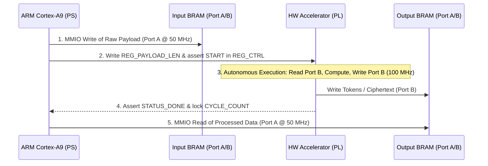

# Heterogeneous SoC Compression & Cryptography Platform (Cora Z7 + ESP32)
## UFMG — DELT: Topics in Computer Engineering (Silicon Systems)

[-red.svg)](#)
[](#)
[](#)
[-green.svg)](#)
[-orange.svg)](#)
[-darkred.svg)](https://www.ufmg.br/)
[]()
[]()

> [!IMPORTANT]
> **Engineering Status — Work-in-Progress (WIP: Testbench & Synthetic Data Pipeline):**  
> This project is in **active development**. Current engineering efforts center on developing a **Python-based synthetic telemetry generator** that produces realistic, time-series sensor streams to rigorously validate the heterogeneous co-design pipeline.
> 
> * **Active Focus: Python Synthetic Telemetry Generator:**
>   - Generates realistic, time-series telemetry streams modeled after industrial sensor clusters (simulated ambient/die temperature, 3-axis vibration signals, supply rail voltages, status bitmasks, and monotonic microsecond timestamps).
>   - Emulates controllable data entropy and repetition profiles to systematically challenge both dictionary compression (RLE, LZ4) and stream/block encryption (AES-CTR, ChaCha20) under known statistical distributions.
>   - Formats binary payloads in strict compliance with the project's binary frame contract ([`spi_frame.h`](esp32/main/spi_frame.h): 64 B to 1024 B payloads, native 32-bit word alignment, and CRC-16 CCITT integrity verification).
> * **Hardware-in-the-Loop (HIL) Testbench Role:**
>   - The ESP32 microcontroller acts as a hardware bridge, streaming test vector frames over high-speed SPI Mode 0 (up to 25 MHz) to the Digilent Cora Z7-10 (Xilinx Zynq-7010).
>   - Synthesizable VHDL-2008 cores for LZSS compression and AES-128-CTR encryption interface via True Dual-Port BRAMs (ADR-012) to an ARM Cortex-A9 bare-metal supervisor.
> * **Benchmark Status:**
>   - All quantitative throughput, execution latency, and speedup metrics across the test matrix are **Pending Measurement / WIP** awaiting systematic physical execution sweeps with the synthetic telemetry generator.

---

## 📌 System Specifications and Physical Parameters

The parameters below define the physical hardware testbed on the Digilent Cora Z7-10:

| Parameter / Magnitude | Symbol | Value | Unit | Implementation Details |
| :--- | :---: | :---: | :---: | :--- |
| **CPU Clock (PS)** | $f_{\text{cpu}}$ | **667** | MHz | ARM Cortex-A9 MPCore (Core 0, bare-metal C11) |
| **Accelerator Clock (PL)** | $f_{\text{accel}}$ | **100** | MHz | Clock domain `FCLK_CLK1` (Artix-7 fabric) |
| **AXI Bus Clock** | $f_{\text{axi}}$ | **50** | MHz | Clock domain `FCLK_CLK0` (`M_AXI_GP0`) |
| **DDR3 Memory Capacity** | $M_{\text{ddr}}$ | **512** | MB | 16-bit wide bus @ 533 MHz (1066 Mbps DDR3) |
| **True Dual-Port BRAM** | $M_{\text{bram}}$ | **4 $\times$ 8 (32)** | KB | 4 independent Block RAM buffers (Port A PS, Port B HW) |
| **External SPI Clock** | $f_{\text{spi}}$ | **Up to 25** | MHz | SPI Mode 0 (CPOL=0, CPHA=0, MSB-First) |
| **Payload Spectrum** | $L_{\text{pay}}$ | **64, 256, 512, 1024** | Bytes | Dynamic frames with CRC-16 CCITT and 0x5A EOF delimiter |
| **LZSS Window Geometry** | $W$ / $L$ | **256 / 16** | Bytes | Sliding circular window ($2^8$) and lookahead buffer ($2^4$) |
| **Cryptographic Primitive** | --- | **AES-128-CTR** | Bits/Mode | NIST SP 800-38A (10 iterative rounds, 11 cycles/block) |
| **FPGA Logic Budget** | --- | **17,600 LUT / 35,200 FF** | Cells | AMD Xilinx Zynq XC7Z010-1CLG400C |
| **ARM PMU Measurement Overhead** | $C_{\text{pmu}}$ | **29** | Cycles | Direct CP15 inline register access (`PMCCNTR`) |

---

## 🗂️ Module Map and Documentation Index

| Subsystem / Module | Source Files | Linked Specification | Architectural Role | Deliverable & Verification Status |
|---|---|:---:|---|---|
| **1. Telemetry Generator (Host)** | `utils/` (Python WIP) | [Architecture §6.3](docs/SYSTEM_ARCHITECTURE.md#63-synthetic-telemetry-generation--esp-idf-ingestion-setup-esp32) | Time-series sensor stream synthesis (temperature, vibration, voltage) | Active WIP; generates test vectors for HIL sweeps |
| **2. SPI Injector (ESP32)** | [`spi_injector_master.c`](esp32/main/spi_injector_master.c) | [SPI_INJECTOR.md](esp32/SPI_INJECTOR.md) | Physical SPI Master bridge for synthetic test vector frames | Mode 0 driver verified; physical HIL sweeps WIP |
| **3. SPI Receiver (PS/PL)** | [`axi_spi_receiver.c`](cora7z/app/sw/src/axi_spi_receiver.c) | [AXI_SPI_RECEIVER.md](cora7z/app/sw/src/AXI_SPI_RECEIVER.md) | 256 B FIFO drainage and 32-bit word alignment | Preamble validation (`0xA5`), CRC check, echo/ACK response |
| **4. Compression Accel (PL)** | [`lzss_accel.vhdl`](cora7z/app/hw/src/lzss_accel.vhdl) | [LZSS_ACCEL.md](cora7z/app/hw/src/LZSS_ACCEL.md) | Sliding window hardware compressor (256 B / 16 B) | RTL verified in VUnit; physical benchmark pending |
| **5. Compression Baseline (PS)** | [`lzss_sw.c`](cora7z/app/sw/src/lzss_sw.c) | [LZSS_SW.md](cora7z/app/sw/src/LZSS_SW.md) | Heatshrink-compatible C11 reference for Cortex-A9 | L1/L2 cache execution, bit-exact parity with HW model |
| **6. Crypto Accel (PL)** | [`aes_accel.vhdl`](cora7z/app/hw/src/aes_accel.vhdl) | [AES_ACCEL.md](cora7z/app/hw/src/AES_ACCEL.md) | Iterative 10-round AES-128-CTR hardware engine | VUnit verified with NIST vectors; benchmark pending |
| **7. Crypto Baseline (PS)** | [`aes_ctr_sw.c`](cora7z/app/sw/src/aes_ctr_sw.c) | [AES_CTR_SW.md](cora7z/app/sw/src/AES_CTR_SW.md) | NIST SP 800-38A reference model in C11 | Golden vector validated; baseline CPU profiling target |
| **8. Pipeline Manager** | [`pipeline_mgr.c`](cora7z/app/sw/src/pipeline_mgr.c) | [PIPELINE_MGR.md](cora7z/app/sw/src/PIPELINE_MGR.md) | Orchestration of 4 scenarios and DEVCFG bus safety | Interlock implemented (`PCFG_DONE`); scenario dispatcher ready |
| **9. Architectural Diagrams** | [`cora7z_top.png`](docs/diagrams/cora7z_top.png) | [Diagrams README](docs/diagrams/README.md) | High-resolution 3200 $\times$ 1800 block diagram | Memory map, bus interconnects, pin allocation |

---

## 1. Data Ingestion Subsystem: Python Generator & AXI Quad SPI

### Technical Details
Data ingestion combines a host-side **Python synthetic telemetry generator** with an **ESP32-WROOM** bridge operating at 240 MHz (ESP-IDF v6.1). Its hardware SPI Master operates in **Mode 0** (CPOL=0, CPHA=0, MSB-First) for synchronous transfers up to 25 MHz.

On the Cora Z7, the physical lines connect to the Xilinx LogiCORE **`axi_quad_spi_0`** IP in slave mode (base address `0x41E00000`), configured with a 256-byte FIFO and routed through Header J7:
* `SCLK` $\to$ Pin `H15` (Header J7.3)
* `MOSI` $\to$ Pin `T12` (Header J7.4)
* `MISO` $\to$ Pin `W15` (Header J7.1)
* `SS_N` $\to$ Pin `F16` (Header J7.5)

```text
 0                   1                   2                   3
 0 1 2 3 4 5 6 7 8 9 0 1 2 3 4 5 6 7 8 9 0 1 2 3 4 5 6 7 8 9 0 1
+-+-+-+-+-+-+-+-+-+-+-+-+-+-+-+-+-+-+-+-+-+-+-+-+-+-+-+-+-+-+-+-+
| Preamble 0xA5 | Pkt Type 0x01 |       Sequence ID (15:0)      | [0..3]
+-+-+-+-+-+-+-+-+-+-+-+-+-+-+-+-+-+-+-+-+-+-+-+-+-+-+-+-+-+-+-+-+
|   Payload Length (15:0)       |   Reserved Padding (0x0000)   | [4..7]
+-+-+-+-+-+-+-+-+-+-+-+-+-+-+-+-+-+-+-+-+-+-+-+-+-+-+-+-+-+-+-+-+
|                  Payload Byte 0 (32-bit aligned)              | [8..]
|                              ...                              |
|                  Payload Byte N-1                             | [8+N-1]
+-+-+-+-+-+-+-+-+-+-+-+-+-+-+-+-+-+-+-+-+-+-+-+-+-+-+-+-+-+-+-+-+
|       CRC-16-CCITT (15:0)     | EOF Delim 0x5A|                 [8+N .. 8+N+2]
+-+-+-+-+-+-+-+-+-+-+-+-+-+-+-+-+-+-+-+-+-+-+-+-+
```

### Architectural Role
* **Synthetic Stream Validation:** Ingests structured telemetry streams modeling multi-channel sensor arrays to exercise compression and encryption stages under repeatable statistical conditions.
* **32-Bit Word Alignment:** The 2-byte `reserved_align` field ensures that `payload[0]` starts at byte offset 8, allowing native 32-bit word reads by the Cortex-A9 CPU and DMA controller.
* **Handshake Sequence:**
  1. The Cora Z7 issues an active-low trigger pulse on **PMOD JA1** (`Y18`) connected to ESP32 **GPIO 32** (or the ESP32 transmits autonomously via FreeRTOS timer pacing).
  2. The ESP32 formats the binary frame with CRC-16 CCITT and initiates the SPI transaction.
  3. The PS driver [`axi_spi_receiver.c`](cora7z/app/sw/src/axi_spi_receiver.c) drains the FIFO into DDR3 and validates frame integrity.

---

## 2. Memory Architecture & Interconnect: BRAM Decoupling (ADR-012)

### Technical Details
To eliminate deadlock hazards associated with variable-length compressed streams in traditional AXI DMA configurations, the platform implements four dedicated **True Dual-Port Block RAMs** (8 KB each):
* **`bmg_lzss_in`** (`0x40000000`) and **`bmg_lzss_out`** (`0x40002000`).
* **`bmg_aes_in`** (`0x40010000`) and **`bmg_aes_out`** (`0x40012000`).

**Port A** connects to AXI BRAM controllers mapped into the CPU memory space (`M_AXI_GP0` @ 50 MHz). **Port B** connects directly to the hardware accelerator datapaths (`clk`, `addr[12:0]`, `din[31:0]`, `dout[31:0]`, `we[3:0]` @ 100 MHz).



### Architectural Benefit
In streaming AXI DMA architectures, if compressed output size is smaller than expected by a DMA descriptor, the S2MM channel can stall awaiting missing bytes, hanging the AXI bus. BRAM decoupling eliminates this failure mode: the accelerator locks the exact output byte count in `REG_PAYLOAD_LEN`, allowing the CPU to read the precise number of bytes generated.

---

## 3. Compression Subsystem: `lzss_accel` & `lzss_sw`

The compression modules implement a Heatshrink-compatible sliding window dictionary algorithm:
* **Sliding Window:** 256-byte circular buffer ($W = 8$).
* **Lookahead Comparison Buffer:** 16 bytes ($L = 4$) with linear window search.
* **Token Packing:** Bit-level token encoding where a `'1'` bit precedes an 8-bit literal byte, and a `'0'` bit precedes an offset-length tuple for repeated sequences of 2 to 16 bytes.
* **Hardware Architecture:** Designed without dynamic heap memory allocation, operating over BRAM Port B at 100 MHz.

---

## 4. Cryptographic Subsystem: `aes_accel` & `aes_ctr_sw`

The encryption module implements AES-128 in Counter (CTR) mode compliant with **NIST FIPS-197** and **NIST SP 800-38A**:
* **Hardware Datapath:** Iterative architecture processing 1 round per clock cycle (SubBytes ROM S-Box, ShiftRows, MixColumns over $GF(2^8)$, and AddRoundKey).
* **On-the-Fly Key Expansion:** Computes round keys dynamically during the 10 iterative rounds.
* **Keystream Generation:** Counter block $T_j = \text{IV} \parallel \text{Counter}_j$ is encrypted to produce a 128-bit keystream block XORed with plaintext in **11 clock cycles per 16-byte block**.
* **Keystream Reuse Prevention:** The monotonic sequence ID (`seq_id`) is bound into the upper 64 bits of the IV, ensuring distinct keystreams across successive packets.

---

## 5. Processing System: PS Supervisor & Bare-Metal Firmware

The bare-metal C11 firmware in [`cora7z/app/sw/src/`](cora7z/app/sw/src/) orchestrates the system:
* **Bus Safety Interlock (`is_pl_programmed`):** Checks Bit 2 of the DEVCFG status register (`0xF800700C`, `PCFG_DONE`). If the FPGA is unprogrammed, accesses to `M_AXI_GP0` are inhibited, preventing fatal Cortex-A9 bus lockups.
* **Cycle-Accurate Profiling (ARM PMU):** Directly accesses CP15 register `PMCCNTR` at 667 MHz with a calibrated overhead of 29 cycles.
* **Zero Dynamic Allocation:** Uses static memory allocation exclusively, adhering to MISRA-C principles.

---

## 6. Benchmark Evaluation Methodology & Test Matrix (WIP)

The experimental framework defines four execution scenarios evaluated across standardized payload sizes (256 B, 512 B, 1024 B). All empirical performance figures are currently **Pending Measurement / WIP** awaiting execution sweeps with the Python synthetic telemetry generator:

| Scenario | Pipeline Description | Payload | Latency | PMU Cycles | PL Cycles | Throughput | Speedup | Status |
| :--- | :--- | :---: | :---: | :---: | :---: | :---: | :---: | :---: |
| **Scenario 1: PS Only** | SW LZSS + SW AES-CTR | 256 B | *Pending* | *Pending* | *0* | *Pending* | *1.00x (Ref)* | Pending HIL Run |
| **Scenario 1: PS Only** | SW LZSS + SW AES-CTR | 512 B | *Pending* | *Pending* | *0* | *Pending* | *1.00x (Ref)* | Pending HIL Run |
| **Scenario 1: PS Only** | SW LZSS + SW AES-CTR | 1024 B | *Pending* | *Pending* | *0* | *Pending* | *1.00x (Ref)* | Pending HIL Run |
| **Scenario 2: Offload Comp** | PL LZSS + SW AES-CTR | 256 B | *Pending* | *Pending* | *Pending* | *Pending* | *Pending* | Pending HIL Run |
| **Scenario 2: Offload Comp** | PL LZSS + SW AES-CTR | 512 B | *Pending* | *Pending* | *Pending* | *Pending* | *Pending* | Pending HIL Run |
| **Scenario 2: Offload Comp** | PL LZSS + SW AES-CTR | 1024 B | *Pending* | *Pending* | *Pending* | *Pending* | *Pending* | Pending HIL Run |
| **Scenario 3: Offload Crypto** | SW LZSS + PL AES-CTR | 256 B | *Pending* | *Pending* | *Pending* | *Pending* | *Pending* | Pending HIL Run |
| **Scenario 3: Offload Crypto** | SW LZSS + PL AES-CTR | 512 B | *Pending* | *Pending* | *Pending* | *Pending* | *Pending* | Pending HIL Run |
| **Scenario 3: Offload Crypto** | SW LZSS + PL AES-CTR | 1024 B | *Pending* | *Pending* | *Pending* | *Pending* | *Pending* | Pending HIL Run |
| **Scenario 4: All Hardware** | PL LZSS + PL AES-CTR | 256 B | *Pending* | *Pending* | *Pending* | *Pending* | *Pending* | Pending HIL Run |
| **Scenario 4: All Hardware** | PL LZSS + PL AES-CTR | 512 B | *Pending* | *Pending* | *Pending* | *Pending* | *Pending* | Pending HIL Run |
| **Scenario 4: All Hardware** | PL LZSS + PL AES-CTR | 1024 B | *Pending* | *Pending* | *Pending* | *Pending* | *Pending* | Pending HIL Run |

### Evaluation Protocol & Metrics
* **Latency ($T_{\text{lat}}$):** Total elapsed time in milliseconds from frame ingestion to completion.
* **CPU Cycles ($C_{\text{PMU}}$):** Sampled via `PMCCNTR` (calibrated: $C_{\text{actual}} = C_{\text{raw}} - 29$).
* **Hardware Cycles ($C_{\text{PL}}$):** Sampled from accelerator status registers at 100 MHz.
* **Throughput ($TH$):** Calculated as $\text{Payload Size} / T_{\text{lat}}$ (MB/s).
* **Speedup ($S$):** Calculated relative to Scenario 1 software baseline.
* **Architectural Risk R9 Investigation:** Characterization sweeps will experimentally evaluate the hypothesis that sequential lookahead searches in BRAM at 100 MHz incur latency penalties compared to Cortex-A9 L1/L2 cache execution at 667 MHz.

### Target FPGA Silicon Resource Budgets (AMD Xilinx XC7Z010)

| Hardware Resource | Device Total Budget | Target Design Budget (85%) | Post-Implementation Utilization | Timing Status |
| :--- | :---: | :---: | :---: | :---: |
| **LUTs (Combinational Logic)** | 17,600 | $\le$ 14,960 | *Pending Closure / WIP* | WNS $\ge 0.0$ ns (Target) |
| **Flip-Flops (Registers)** | 35,200 | $\le$ 29,920 | *Pending Closure / WIP* | — |
| **Block RAM (RAMB36 Equivalents)** | 60 | $\le$ 51 | *Pending Closure / WIP* | — |
| **DSP48E1 Slices** | 80 | $\le$ 68 | *Pending Closure / WIP* | — |

---

## 7. Build, Simulation & Execution Runbook

### 1. Environment Setup
Prerequisites:
* Ubuntu Linux 22.04 / 24.04 LTS
* AMD Xilinx Vivado and Vitis 2026.1
* GHDL 4.1+ and Python with VUnit (`pip install vunit_hdl`)
* Espressif ESP-IDF v6.1+

Source the unified environment script:
```bash
source .agents/env.sh
```

### 2. RTL Simulation (VUnit + GHDL)
```bash
make -C cora7z/app/hw venv
make -C cora7z/app/hw test
```

### 3. Hardware Platform Build (Vivado Batch Mode)
```bash
bash cora7z/app/hw/scripts/run_vivado.sh cora7z/app/hw/scripts/build_bitstream.tcl
```
*Generates:* `cora7z/app/hw/vivado/cora7z_top.xsa` containing the integrated bitstream.

### 4. Bare-Metal Application Compilation (Vitis Python CLI)
```bash
vitis -s cora7z/app/sw/scripts/build_sw.py
```
*Generates:* `cora7z/app/sw/vitis/cora7z_firmware/build/cora7z_firmware.elf`.

### 5. Flash ESP32 Synthetic Data Injector
Connect ESP32 via USB (e.g. `/dev/ttyACM0`):
```bash
cd esp32
idf.py build
idf.py -p /dev/ttyACM0 flash monitor
```

### 6. Program and Launch Cora Z7
Connect the Cora Z7 via USB JTAG/UART:
```bash
# Terminal 1: Monitor UART output
picocom -b 115200 /dev/ttyUSB1

# Terminal 2: Download bitstream, FSBL, and application ELF
vitis -s cora7z/app/sw/scripts/launch_app.py
```

---

## 8. Repository Layout

```text
ufmg/soc/proj/
├── cora7z/
│   └── app/
│       ├── hw/                 # VHDL-2008 RTL, constraints, synthesis scripts
│       │   ├── src/            # LZSS_ACCEL.md, AES_ACCEL.md, INTERFACES.md
│       │   ├── test/           # tb_lzss_accel.vhdl, tb_aes_accel.vhdl (VUnit)
│       │   ├── scripts/        # configure_block_design.tcl, build_bitstream.tcl, run_vivado.sh
│       │   └── utils/          # cora_z7_io.xdc, cora_z7_pins.json
│       └── sw/                 # C11 Bare-metal firmware (ARM Cortex-A9)
│           ├── src/            # LZSS_SW.md, AES_CTR_SW.md, PIPELINE_MGR.md, AXI_SPI_RECEIVER.md
│           └── scripts/        # build_sw.py, launch_app.py
├── esp32/                      # Autonomous SPI synthetic injector (ESP-IDF v6.1)
│   ├── main/                   # main.c, spi_injector_master.c, spi_frame.h
│   └── components/ui_controller
├── docs/                       # Architectural specifications and diagrams
│   ├── SYSTEM_ARCHITECTURE.md
│   ├── AES_CTR_ALGORITHM.md
│   └── diagrams/               # cora7z_top.png (3200x1800), generate_soc_diagram.py
├── utils/
│   └── plan/                   # Project tracking schedules and metrics
│       ├── Cronograma_e_Tarefas.csv
│       ├── Matriz_de_Testes_e_Métricas.csv
│       ├── Checklist_de_Entregaveis.csv
│       ├── Riscos_e_Bloqueios.csv
│       └── STATUS.md
└── README.md                   # Primary system documentation
```

---

## 9. Deliverables Compliance Summary

| Deliverable | Format | Status | Location |
|---|:---:|:---:|---|
| **VHDL Source Code** | `.vhdl` | Scaffold Complete | [`cora7z/app/hw/src/`](cora7z/app/hw/src/) (`lzss_accel.vhdl`, `aes_accel.vhdl`) |
| **VUnit Testbenches** | `.vhdl` | Verified (Simulation) | [`cora7z/app/hw/test/`](cora7z/app/hw/test/) (`tb_lzss_accel.vhdl`, `tb_aes_accel.vhdl`) |
| **C/C++ Firmware** | `.c`, `.h` | Scaffold Complete | [`cora7z/app/sw/src/`](cora7z/app/sw/src/) and [`esp32/main/`](esp32/main/) |
| **Block Diagram** | `.png`, `.jpg` | Complete | [`docs/diagrams/cora7z_top.png`](docs/diagrams/cora7z_top.png) (3200 $\times$ 1800) |
| **Final Report** | `.pdf` | Pending HIL Benchmarks | In preparation; metrics pending physical execution |
| **GitHub Repository** | Git URL | Active | [git@github.com:luishrmc/soc-proj.git](https://github.com/luishrmc/soc-proj) |
