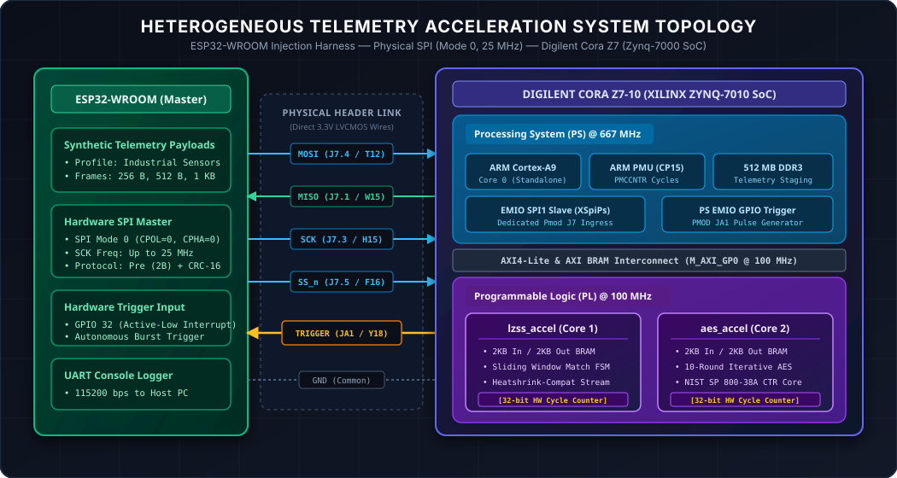
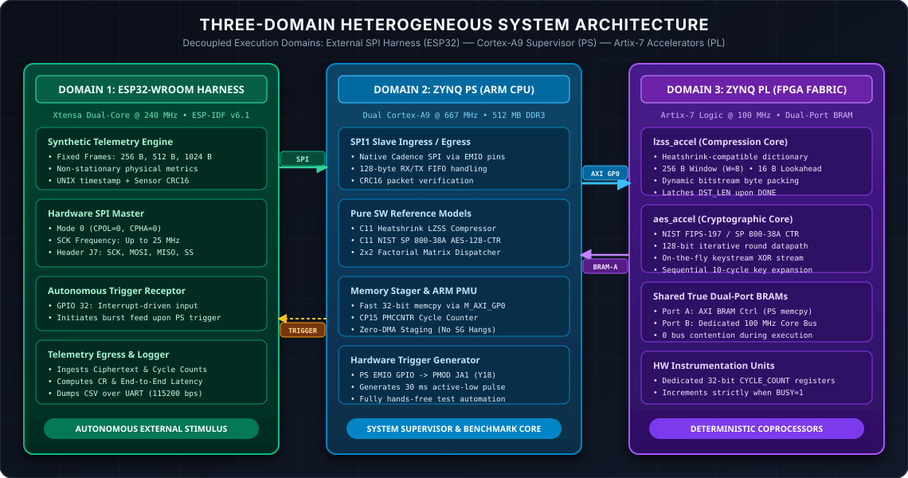
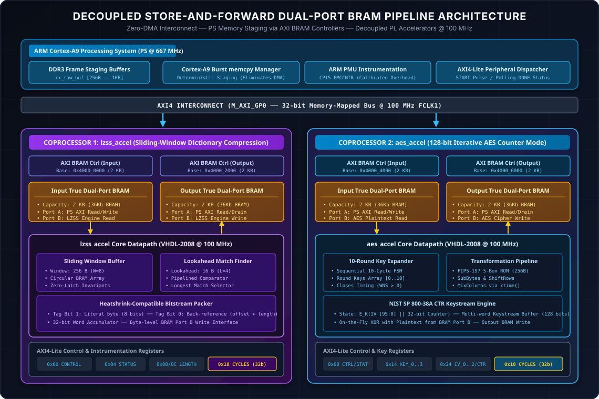
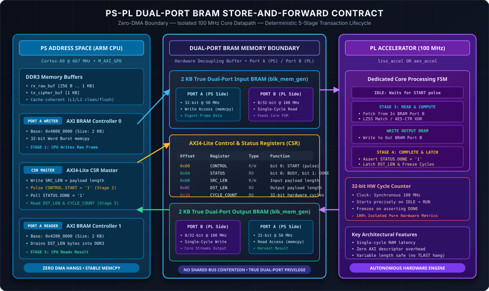
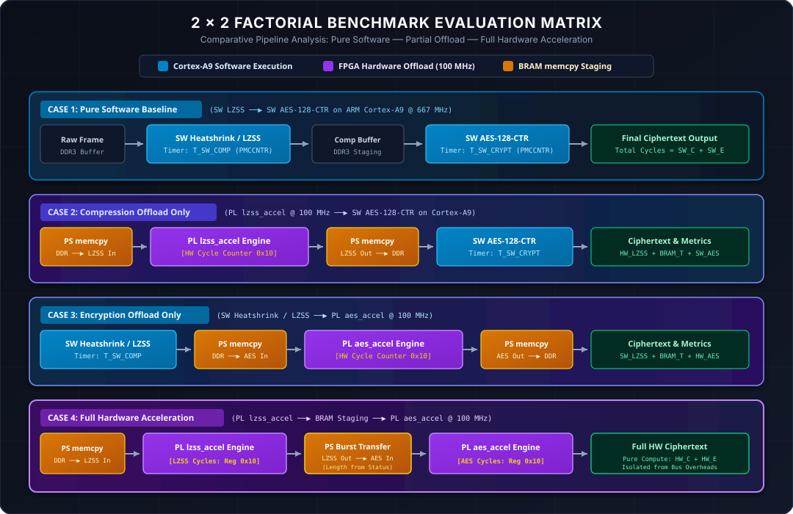

# Heterogeneous SoC Telemetry Acceleration (Cora Z7 + ESP32)

[-red.svg)](#)
[](#)
[](#)
[](#)
[-yellow.svg)](#)

---

### Executive Summary & Problem Statement

Distributed Internet of Things (IoT) edge nodes and industrial telemetry gateways continuously ingest dense telemetry streams (sensor readings, timestamps, environmental matrices, and diagnostics). Transmitting this raw telemetry directly over bandwidth-constrained or metered wireless networks (e.g., Cellular LTE-M/NB-IoT, Satellite, LoRaWAN, Wi-Fi) introduces severe performance and financial penalties:
1. **Bandwidth Saturation & Uplink Costs:** High data volume increases radio transmission duty cycle, inflating operational power consumption and recurrent data fees.
2. **Data Confidentiality & Spoofing Risks:** Telemetry traversing untrusted transit networks requires authenticated symmetric encryption to safeguard industrial assets.

#### The Fundamental Pipeline Invariant: Compress-then-Encrypt

Modern cryptographic block and stream ciphers (such as AES-CTR) produce ciphertext indistinguishable from a pseudorandom sequence, exhibiting near-maximal Shannon entropy ($H(X) \approx 8$ bits/byte). Standard dictionary compression algorithms rely on discovering recurrent byte patterns and statistical redundancy; therefore, **encrypted data cannot be compressed** (compression ratio drops to $0\%$, or inflates size due to metadata overhead).

Consequently, the telemetry processing pipeline must strictly execute **Compress-then-Encrypt**:

$$\text{Raw Telemetry Frame} \xrightarrow[\text{Redundancy Reduction}]{\text{LZSS / Heatshrink}} \text{Compressed Stream} \xrightarrow[\text{Confidentiality}]{\text{AES-128-CTR}} \text{Ciphertext Frame}$$

#### Engineering Motivation & The Heterogeneous SoC Advantage

Executing sequential dictionary compression followed by cryptographic encryption purely on embedded CPUs creates significant computational overhead, elevating latency and depleting CPU cycles needed for real-time control. This project investigates and characterizes hardware acceleration on a heterogeneous System-on-Chip (**AMD Xilinx Zynq-7010 on the Digilent Cora Z7**), offloading compute-intensive kernels to dedicated Artix-7 FPGA coprocessors while retaining flexible software supervision on the dual-core ARM Cortex-A9.

---

## 1. System Architecture & Topology

The platform integrates two physical hardware subsystems: an external **ESP32-WROOM** test harness acting as an autonomous SPI master, and the **Digilent Cora Z7-10** development board housing the Zynq-7000 SoC.



### 1.1 Hardware Partitioning & Execution Domains

The system is partitioned into three distinct execution domains:



The following table summarizes the architectural profile, execution model, and primary responsibilities of each domain:

| Domain | Subsystem / Hardware | Clock Frequency | Execution Environment | Core Responsibilities |
| :--- | :--- | :---: | :--- | :--- |
| **Domain 1: Ingestion Harness** | Espressif ESP32-WROOM | 240 MHz | Dual Xtensa LX6 (ESP-IDF v6.1) | Autonomous synthetic telemetry generation (256 B–1 KB), SPI Master (Mode 0, up to 25 MHz), hardware trigger reception, UART console metrics logging |
| **Domain 2: System Supervisor** | Zynq-7000 Processing System (PS) | 667 MHz | Dual ARM Cortex-A9 (Bare-Metal C11) | Native SPI1 EMIO interface, DDR3 staging buffers, software baseline execution (LZSS & AES-CTR), burst `memcpy` via `M_AXI_GP0`, ARM PMU instrumentation |
| **Domain 3: Coprocessor Fabric** | Zynq-7000 Programmable Logic (PL) | 100 MHz | AMD Xilinx Artix-7 Fabric | Decoupled `lzss_accel` & `aes_accel`, True Dual-Port BRAM buffers (Port A: PS, Port B: Core), 32-bit hardware cycle counters, zero-arbitration processing |

#### A. ESP32-WROOM (Autonomous Test Harness & Data Injector)
* **Isolated Environment:** Operates completely decoupled from external cloud or Wi-Fi networks, guaranteeing deterministic and jitter-free transmission timing.
* **Telemetry Storage:** Houses pre-generated synthetic telemetry frames (standardized sizes: 256 B, 512 B, 1024 B) structured with realistic floating-point sensor metrics, UNIX timestamps, station tags, and status words.
* **SPI Master:** Feeds frames to the Cora Z7 over SPI Mode 0 (up to 25 MHz) upon receiving an autonomous trigger pulse from the Cora Z7 PS.
* **Egress Verification:** Reads back ciphertext packets, compression ratios, and cycle counts, logging performance reports to a host terminal over UART (115200 bps).

#### B. Processing System (PS: Dual ARM Cortex-A9 @ 667 MHz)
* **SPI Ingress / Egress:** Receives external frames via the native Zynq `SPI1` controller routed through EMIO to dedicated physical board headers (Header J7).
* **Software Baseline Execution:** Runs standalone C11 reference implementations of LZSS/Heatshrink and AES-128-CTR to measure CPU-bound baseline performance.
* **Memory Staging & Offload Supervisor:** Manages frame handoffs between DDR3 staging buffers and PL coprocessors via fast memory copies over the 32-bit `M_AXI_GP0` bus, completely bypassing brittle DMA scatter-gather engines.
* **Cycle-Accurate Benchmarking:** Measures CPU cycles using the ARM Performance Monitor Unit (PMU / CP15 `PMCCNTR`) and polls PL hardware cycle registers.
* **Hardware Trigger Output:** Generates an active-low pulse on PMOD JA Pin 1 (Package Pin `Y18`) to initiate bursts from the ESP32 without manual push-buttons.

#### C. Programmable Logic (PL: Artix-7 FPGA Fabric @ 100 MHz)
* **Decoupled Architecture:** Features two completely independent, non-multiplexed hardware accelerators:
  1. `lzss_accel`: Sliding-window dictionary compressor.
  2. `aes_accel`: Iterative 128-bit AES counter-mode encryptor.
* **Shared BRAM Buffers:** Each core is encapsulated between dedicated True Dual-Port Block RAM buffers (Input BRAM and Output BRAM) driven by standard AXI BRAM Controllers.
* **Dedicated Hardware Profiling:** Each core integrates a local 32-bit hardware cycle counter that increments strictly while its computing FSM is active and latches upon asserting `DONE`.

---

## 2. Decoupled Hardware Coprocessors (PL)

Dynamic streaming multiplexers (`axis_accel_mux`) and AXI DMA engines have been retired in favor of **Shared Dual-Port Block RAM Coprocessors** ([ADR-017](file:///home/luis/ufmg/soc/proj/utils/memory/decisions.md)). Compression of non-stationary telemetry yields non-deterministic output lengths; streaming AXI DMA S2MM channels hang if the transferred byte count does not match programmed descriptors, leading to CPU bus lockups. Shared True Dual-Port BRAM buffers eliminate this vulnerability entirely.



### 2.1 Memory & Register Interface Layout

Data and control movement across the PS-PL boundary follows a strict store-and-forward contract:



#### Store-and-Forward Transaction Lifecycle

The interaction between the ARM Cortex-A9 CPU and the PL accelerators progresses through five deterministic, sequential phases:

| Phase | Operation Name | Initiator | Bus / Port | Transaction Description | Latency & Synchronization |
| :---: | :--- | :--- | :--- | :--- | :--- |
| **Stage 1** | **Ingest & Stage** | ARM Cortex-A9 | `M_AXI_GP0` $\to$ Port A | CPU copies raw frame from DDR3 to Input BRAM (32-bit burst `memcpy`) | Deterministic memory write; bypasses DMA descriptor rings |
| **Stage 2** | **Arm & Dispatch** | ARM Cortex-A9 | `M_AXI_GP0` $\to$ AXI4-Lite | Writes `SRC_LEN` and pulses `CONTROL.START = '1'` (`0x00`) | Single MMIO write; resets internal cycle counter |
| **Stage 3** | **Autonomous Compute** | Core FSM (`lzss` / `aes`) | Port B (100 MHz) | Core reads from Input BRAM Port B, executes algorithm, writes to Output BRAM Port B | Single-cycle synchronous RAM; zero bus contention |
| **Stage 4** | **Completion Latch** | Core FSM | Internal CSR Logic | Core asserts `STATUS.DONE = '1'`, latches output byte count in `DST_LEN`, freezes `CYCLE_COUNT` | Cycle-accurate measurement; no CPU interrupt jitter |
| **Stage 5** | **Harvest & Drain** | ARM Cortex-A9 | `M_AXI_GP0` $\to$ Port A | CPU detects `DONE = '1'`, reads `CYCLE_COUNT` & `DST_LEN`, drains Output BRAM to DDR3 | Complete isolation from variable-length stream issues |

#### Memory & Port Interface Definition

1. **Port A (PS CPU Interface):**
   - Memory-mapped into the ARM Cortex-A9 physical address space via standard AMD Xilinx AXI BRAM Controllers (`0x40000000` for Input BRAM, `0x42000000` for Output BRAM).
   - Operates in the 50 MHz `FCLK_CLK0` domain with 32-bit data width.
   - Used exclusively by the CPU for burst `memcpy` staging and harvesting.
2. **Port B (PL Accelerator Interface):**
   - Directly wired to the accelerator core datapath in the 100 MHz `clk_accel` domain (`FCLK_CLK1`).
   - Provides deterministic, single-cycle read and write access without bus arbiters, crossbars, or contention.
3. **AXI4-Lite Control & Status Registers (CSR):**
   - Dedicated 32-bit memory-mapped registers expose control signals, status flags, payload lengths, and cycle metrics:

| Register Offset | Register Name | Access Type | Reset Value | Description |
| :---: | :--- | :---: | :---: | :--- |
| `0x00` | `CONTROL` | R/W | `0x00000000` | Control register: bit 0 = `START` (self-clearing pulse), bit 1 = `RESET_CORE` |
| `0x04` | `STATUS` | RO | `0x00000000` | Status register: bit 0 = `BUSY`, bit 1 = `DONE`, bit 2 = `ERR` |
| `0x08` | `SRC_LEN` | R/W | `0x00000000` | Input block length in bytes (32-bit unsigned integer) |
| `0x0C` | `DST_LEN` | RO | `0x00000000` | Processed output block length in bytes (latched upon completion) |
| `0x10` | `CYCLE_COUNT` | RO | `0x00000000` | Hardware latency: active 100 MHz clock cycles during computation |
| `0x14`–`0x30` | `KEY_x` / `IV_x` | R/W | `0x00000000` | Cryptographic key, IV, and initial counter words (AES-128 core only) |

> [!NOTE]
> **Why Store-and-Forward Dual-Port BRAM Eliminates DMA Failure Modes:**
> Compression algorithms on real-world telemetry produce variable-length output blocks that cannot be predicted a priori. In conventional streaming DMA pipelines (e.g., AXI DMA in Simple or Scatter-Gather mode), an under-length or over-length stream without a perfectly aligned `TLAST` packet boundary leads to DMA receiver hangs, unserviced interrupts, and CPU bus lockups. With Dual-Port BRAM, the hardware core autonomously determines the final length, writes the exact byte count to `DST_LEN`, and flags `DONE`. The CPU then safely reads the exact number of bytes produced.

### 2.2 Core Technical Breakdown

#### Core 1: `lzss_accel` (Sliding-Window Dictionary Compression)
* **Algorithm:** LZSS compression compatible with the embedded Heatshrink bitstream format.
* **Sliding Window:** Implements a circular history buffer ($2^W = 256$ bytes, $W=8$) in internal synchronous block RAM.
* **Match Finder:** 16-byte lookahead buffer ($2^L = 16$ bytes, $L=4$) with a pipelined search FSM. It determines the longest back-reference within the window; matches equal to or exceeding 2 bytes are encoded as back-references `(offset, length)`, while non-matching bytes are emitted as literal tags.
* **Bitstream Output:** Formats a variable-length bitstream packed into bytes: tag bit `'1'` prefixes an 8-bit literal, while tag bit `'0'` prefixes back-reference tokens.
* **Hardware Instrumentation:** An internal 32-bit hardware cycle counter increments only while the search/packing FSM is running. Upon reaching the end of the input buffer, `DONE` asserts and the final compressed length is latched into `DST_LEN`.

#### Core 2: `aes_accel` (128-bit Symmetric Cryptographic Coprocessor)
* **Algorithm:** Advanced Encryption Standard (AES-128) in Counter Mode (CTR) per NIST FIPS-197 and NIST SP 800-38A.
* **Iterative Datapath:** Features an unrolled round datapath performing SubBytes (via synthesizable FIPS-197 S-Box ROM tables), ShiftRows, MixColumns (using Galois field $\text{GF}(2^8)$ multiplication `xtime`), and AddRoundKey.
* **Sequential Key Expansion:** To guarantee timing closure at 100 MHz without multi-cycle setup violations, key expansion computes the 10 round keys sequentially over 10 clock cycles upon initialization.
* **CTR Keystream Generation:** For each 128-bit block, the core encrypts the counter block $T_j = IV \parallel \text{Counter}_j$, producing keystream $O_j = E_K(T_j)$. The keystream is XORed on-the-fly with plaintext bytes fetched from Input BRAM Port B and written directly to Output BRAM Port B.
* **Hardware Instrumentation:** Cycle counter runs from the moment `START` is pulsed until the final block is encrypted and written to BRAM.

---

## 3. Benchmarking & Evaluation Methodology

To rigorously answer how hardware offloading compares with pure CPU execution, the system implements a **$2 \times 2$ factorial evaluation matrix**:



### 3.1 The 4 Benchmark Configurations

Every incoming telemetry frame is processed through four distinct operational scenarios:

| Case | Name | Compression Stage | Encryption Stage | Data Movement |
| :---: | :--- | :--- | :--- | :--- |
| **Case 1** | **Pure Software Baseline** | Cortex-A9 SW Heatshrink | Cortex-A9 SW AES-CTR | Pure DDR3 memory buffers |
| **Case 2** | **Compression Offload** | PL `lzss_accel` (100 MHz) | Cortex-A9 SW AES-CTR | DDR $\to$ LZSS In BRAM $\to$ Out BRAM $\to$ DDR |
| **Case 3** | **Encryption Offload** | Cortex-A9 SW Heatshrink | PL `aes_accel` (100 MHz) | DDR $\to$ AES In BRAM $\to$ Out BRAM $\to$ DDR |
| **Case 4** | **Full Hardware Offload** | PL `lzss_accel` (100 MHz) | PL `aes_accel` (100 MHz) | DDR $\to$ LZSS BRAM $\to$ AES BRAM $\to$ DDR |

### 3.2 Evaluation Metrics & Instrumentation Rigor

* **ARM PMU Cycles (`PMCCNTR`):** Reads the Cortex-A9 Performance Monitor Unit cycle counter via CP15 register `c9` with calibrated execution overhead subtracted.
* **Hardware Compute Cycles (`CYCLE_COUNT`):** Dedicated 32-bit hardware registers in PL cores measure exact algorithmic computation latency isolated from AXI bus contention and software interrupt jitter.
* **Effective Throughput:** Calculated over frame payload length:
  $$\text{Throughput (MB/s)} = \frac{\text{Payload Size (Bytes)}}{\text{Total Execution Latency } (\mu s)}$$
* **Compression Ratio:** Quantifies redundancy reduction:
  $$\text{CR} = \left( 1 - \frac{\text{Compressed Size}}{\text{Raw Size}} \right) \times 100\%$$
* **Resource Utilization:** FPGA slice logic (LUTs, FFs), DSP48 slices, and 36 Kb Block RAMs extracted directly from post-implementation Vivado reports.

---

## 4. Repository Structure & Hardware Pin Mapping

The repository adheres to a clean, decoupled layout separating synthesizable RTL, bare-metal firmware, verification harnesses, and project governance:

```
.
├── cora7z/
│   └── app/
│       ├── hw/                 # Hardware RTL & Vivado flow
│       │   ├── src/            # Synthesizable VHDL-2008 sources & INTERFACES.md
│       │   │   ├── aes_ctr_engine.vhdl
│       │   │   └── INTERFACES.md
│       │   ├── test/           # Self-checking VUnit testbenches (tb_*.vhdl)
│       │   ├── scripts/        # Non-interactive Vivado Tcl automation
│       │   │   ├── build_bitstream.tcl
│       │   │   ├── configure_block_design.tcl
│       │   │   └── run_vivado.sh
│       │   ├── utils/          # Pin and timing constraints (DO NOT HARDCODE)
│       │   │   ├── cora_z7_pins.json   # Machine-readable pin definitions
│       │   │   └── cora_z7_io.xdc     # Physical XDC constraints
│       │   ├── Makefile        # VUnit simulation harness entry point
│       │   └── run.py          # VUnit Python test runner
│       └── sw/                 # Software & bare-metal firmware (Vitis unified flow)
│           ├── src/            # C11 bare-metal source files
│           │   ├── main.c              # Baseline boot, PMU calibration & SPI loop
│           │   ├── aes_ctr.c/.h        # NIST SP 800-38A reference model
│           │   ├── axi_spi_receiver.c  # SPI slave driver & CRC-16 parser
│           │   └── axi_io.h            # Low-level MMIO access macros
│           └── scripts/        # Vitis 2026.1 Unified Python CLI scripts
│               ├── build_sw.py         # Automated platform, BSP, and ELF compilation
│               └── launch_app.py       # Automated XSDB bitstream programming & run
├── esp32/                      # ESP32 SPI test harness (ESP-IDF v6.1)
│   ├── main/main.c             # SPI master payload sender & reporter
│   └── CMakeLists.txt
├── docs/                       # Architectural documentation & academic report
│   ├── AES_CTR_ALGORITHM.md
│   └── SYSTEM_ARCHITECTURE.md
└── utils/                      # Governance, project plan, and vector assets
    ├── imgs/                   # Responsive SVG system architecture diagrams
    │   ├── system_topology.svg
    │   ├── system_execution_domains.svg
    │   ├── bram_pipeline_architecture.svg
    │   ├── bram_store_forward_contract.svg
    │   └── benchmark_matrix_flow.svg
    ├── memory/                 # Technical memory, ADR log, and lessons learned
    │   ├── INDEX.md
    │   ├── decisions.md        # Append-only Architectural Decision Records
    │   └── lessons.md          # Toolchain quirks and operational rules
    └── plan/                   # DELT UFMG project management CSVs
        ├── Cronograma_e_Tarefas.csv
        ├── Matriz_de_Testes_e_Métricas.csv
        ├── Checklist_de_Entregaveis.csv
        ├── Riscos_e_Bloqueios.csv
        └── STATUS.md           # Automated progress summary
```

### 4.1 Dynamic Pin Mapping Policy

To maintain portability and avoid board routing faults, **pin numbers, base addresses, and clock frequencies are never hardcoded in documentation or source files**. All hardware connections are dynamically verified against:
* [`cora7z/app/hw/utils/cora_z7_pins.json`](file:///home/luis/ufmg/soc/proj/cora7z/app/hw/utils/cora_z7_pins.json)
* [`cora7z/app/hw/utils/cora_z7_io.xdc`](file:///home/luis/ufmg/soc/proj/cora7z/app/hw/utils/cora_z7_io.xdc)

| Signal Name | Cora Z7 FPGA Pin | Header / Pin | Standard | Direction | Description |
| :--- | :---: | :---: | :---: | :---: | :--- |
| `spi_sck_i`  | `H15` | Header J7 Pin 3 | LVCMOS33 | Input  | SPI serial clock from ESP32 (up to 25 MHz) |
| `spi_mosi_i` | `T12` | Header J7 Pin 4 | LVCMOS33 | Input  | Master-Out Slave-In serial telemetry |
| `spi_miso_o` | `W15` | Header J7 Pin 1 | LVCMOS33 | Output | Master-In Slave-Out ciphertext and metrics |
| `spi_ss_i`   | `F16` | Header J7 Pin 5 | LVCMOS33 | Input  | Active-low chip select with internal pull-up |
| `esp32_trigger_o` | `Y18` | PMOD JA Pin 1 | LVCMOS33 | Output | Autonomous active-low burst trigger from PS EMIO GPIO |
| `GND`        | `GND` | Header J7 Pin 6 | -        | Ground | Common ground reference |

---

## 5. Build & Quick Start Guide

### 5.1 Toolchain Prerequisites

Ensure the following development environments are installed and configured:
* **Host OS:** Ubuntu Linux 22.04 LTS / 24.04 LTS
* **FPGA & Embedded Tools:** AMD Xilinx Vivado & Vitis 2026.1 (loaded via `.agents/env.sh`)
* **Simulation Tools:** GHDL 4.1+ and Python 3.10+ (VUnit framework)
* **Microcontroller Toolchain:** Espressif ESP-IDF v6.1+

Load the environment variables before invoking any build tools:
```bash
source .agents/env.sh
```

---

### 5.2 Verification & Simulation (VUnit + GHDL)

The repository provides a fast, self-checking VUnit test harness for hardware RTL verification:

```bash
# 1. Create Python virtual environment and install VUnit
make -C cora7z/app/hw venv

# 2. Run all active testbenches (AES-128-CTR golden vectors)
make -C cora7z/app/hw test

# 3. View simulation waveforms in GTKWave
make -C cora7z/app/hw view TB=aes
```

---

### 5.3 Hardware Synthesis & Bitstream Generation (Vivado Batch)

Synthesize the design, implement logic, close timing at 100 MHz, and generate the hardware container `.xsa`:

```bash
# Non-interactive bitstream build and platform export
bash cora7z/app/hw/scripts/run_vivado.sh cora7z/app/hw/scripts/build_bitstream.tcl
```
*Output container generated:* `cora7z/app/hw/vivado/cora7z_top.xsa` (bundled with `cora7z_top.bit`).

---

### 5.4 Bare-Metal Firmware Compilation (Vitis Unified CLI)

Compile the standalone Board Support Package (BSP) and ARM Cortex-A9 firmware using the Vitis Python API:

```bash
# Build platform component, generate xparameters.h, and compile cora7z_firmware.elf
vitis -s cora7z/app/sw/scripts/build_sw.py
```
*Output binary generated:* `cora7z/app/sw/vitis/cora7z_firmware/build/cora7z_firmware.elf`.

---

### 5.5 Target Execution on Cora Z7 Hardware

Connect the Digilent Cora Z7 board via Micro-USB and program both the bitstream and application binary over JTAG via XSDB:

```bash
# Programs bitstream, executes FSBL to initialize DDR/clocks, and launches firmware
vitis -s cora7z/app/sw/scripts/launch_app.py
```

Open a serial terminal to observe the Cortex-A9 UART output:
```bash
picocom -b 115200 /dev/ttyUSB1
```

---

### 5.6 ESP32 Test Harness Setup

Connect the ESP32 board to the Cora Z7 board according to the pinout table in Section 4.1. Flash and run the injector:

```bash
cd esp32
idf.py set-target esp32
idf.py build
idf.py -p /dev/ttyUSB0 flash monitor
```
