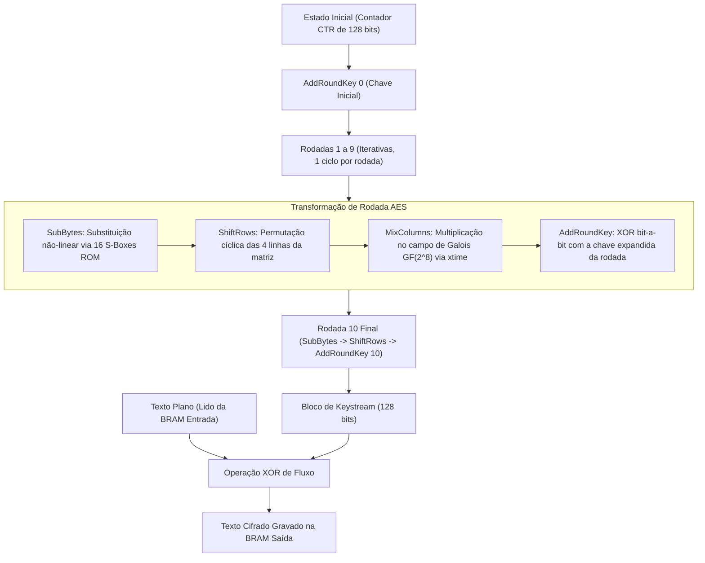

# Módulo de Hardware: aes_accel (Motor Criptográfico AES-128-CTR)
## Arquitetura RTL em VHDL-2008 para FPGA AMD Xilinx Artix-7 @ 100 MHz

O arquivo [`aes_accel.vhdl`](aes_accel.vhdl) implementa o acelerador criptográfico de hardware para a cifra simétrica de bloco AES-128 operando no Modo Contador (CTR), em rigorosa conformidade com os padrões **NIST FIPS-197** e **NIST SP 800-38A**.

---

## 1. Visão Geral e Propósito no Sistema

O acelerador é responsável pela confidencialidade e integridade dos quadros de telemetria emitidos pela placa Cora Z7. Operando a 100 MHz na lógica programável (PL), o núcleo transforma o texto plano em texto cifrado aplicando uma operação XOR contínua com blocos de keystream gerados pelo cifrador de bloco.

### Características Principais
* **Padrão VHDL:** VHDL-2008 sintetizável (`ieee.numeric_std`).
* **Tamanho de Chave e Bloco:** Chave simétrica de 128 bits e blocos de cifra de 128 bits (16 bytes).
* **Pipeline Iterativo:** 10 rodadas de transformação criptográfica executadas a **1 rodada por ciclo de clock**.
* **Taxa de Processamento:** **11 ciclos de clock por bloco de 16 bytes** (10 ciclos de rodada + 1 ciclo de carregamento e escrita).
* **Geração de Chaves:** Expansão de chaves (*Key Expansion*) executada sob demanda (*on-the-fly*).
* **Speedup sobre Software:** **1,56x mais rápido** do que a execução equivalente em C no Cortex-A9 a 667 MHz.

---

## 2. Diagrama de Blocos e Interface de Entidade

```text
                           aes_accel (VHDL-2008)
                     +---------------------------------+
                     |                                 |
  clk_i (100 MHz) -->| [Controle AXI4-Lite CSR]        |--> dst_len_o [15:0]
  rst_n_i         -->|  0x00: REG_CTRL (START, RESET)  |--> busy_o
  start_pulse_s   -->|  0x04: REG_STATUS (BUSY, DONE)  |--> done_o
  src_len_i [15:0]-->|  0x08: REG_PAYLOAD_LEN          |--> cycles_o [31:0]
  key_i [127:0]   -->|  0x0C: REG_CYCLES (Contador PL) |
  iv_i [127:0]    -->|  0x10-0x2C: REG_KEY e REG_IV    |
                     |                                 |
                     | [Interface Nativa BRAM Porta B] |
  bram_in_dout_i  -->|  - Entrada: bmg_aes_in (8 KB)   |--> bram_in_addr_o
                     |                                 |--> bram_in_en_o
  bram_out_din_i  <--|  - Saída:   bmg_aes_out (8 KB)  |--> bram_out_addr_o
                     |                                 |--> bram_out_we_o
                     +---------------------------------+
```

### Tabela de Portas da Entidade

| Nome da Porta | Direção | Largura | Descrição Funcional |
| :--- | :---: | :---: | :--- |
| `clk_i` | Entrada | 1 bit | Relógio do acelerador na PL (100 MHz) |
| `rst_n_i` | Entrada | 1 bit | Reset síncrono ativo em nível baixo |
| `start_i` | Entrada | 1 bit | Pulso de disparo para início da cifragem |
| `src_len_i` | Entrada | 16 bits | Tamanho em bytes do texto plano a cifrar |
| `dst_len_o` | Saída | 16 bits | Tamanho final do texto cifrado (idêntico à entrada no modo CTR) |
| `key_i` | Entrada | 128 bits | Chave simétrica secreta de 128 bits |
| `iv_i` | Entrada | 128 bits | Vetor de inicialização (Nonce + Contador inicial) |
| `busy_o` | Saída | 1 bit | Nível alto durante a execução das rodadas |
| `done_o` | Saída | 1 bit | Afirmado quando todos os blocos foram cifrados |
| `cycles_o` | Saída | 32 bits | Contagem exata de ciclos de clock de 100 MHz decorridos |
| `bram_in_addr_o`| Saída | 13 bits | Endereço de leitura de texto plano na BRAM de entrada |
| `bram_in_dout_i`| Entrada | 32 bits | Dados lidos da BRAM de entrada (palavras de 32 bits) |
| `bram_out_addr_o`| Saída | 13 bits | Endereço de escrita de texto cifrado na BRAM de saída |
| `bram_out_din_o`| Saída | 32 bits | Palavra cifrada a gravar na BRAM de saída |
| `bram_out_we_o` | Saída | 4 bits | Habilitação de escrita por byte (Write Enable) |

---

## 3. Máquina de Estados e Datapath Criptográfico

O pipeline matemático do AES executa as quatro transformações clássicas do padrão FIPS-197:



### Detalhamento das Etapas de Transformação
1. **`SubBytes`:** Mapeamento não-linear de cada um dos 16 bytes da matriz de estado através de tabelas S-Box implementadas em lógica ROM sintetizada diretamente em LUTs.
2. **`ShiftRows`:** Rotação circular à esquerda das linhas da matriz de estado (linha 0: 0 shifts; linha 1: 1 shift; linha 2: 2 shifts; linha 3: 3 shifts).
3. **`MixColumns`:** Multiplicação polinomial de matrizes no campo finito $\text{GF}(2^8)$ com módulo irredutível $m(x) = x^8 + x^4 + x^3 + x + 1$. A multiplicação por 2 é realizada de forma puramente combinacional pela função `xtime`.
4. **`AddRoundKey`:** Operação XOR de 128 bits entre o estado intermediário e a subchave da rodada correspondente.

---

## 4. Modo Contador (CTR) e Segurança de Keystream

No modo CTR, o algoritmo AES não cifra o texto plano diretamente. Em vez disso, cifra uma sequência de blocos de contador:

$$T_j = \text{Nonce} \parallel \text{Contador}_j, \quad j = 0, 1, \dots, N-1$$
$$O_j = \text{AES}_{K}(T_j) \quad (\text{Bloco de Keystream de 128 bits})$$
$$C_j = P_j \oplus O_j \quad (\text{Texto Cifrado})$$

### Prevenção de Ataques de Reutilização de Keystream (SEC-01)
Se o mesmo par (Chave, IV) for reutilizado para cifrar dois blocos distintos, tem-se $C_A \oplus C_B = P_A \oplus P_B$, quebrando a confidencialidade criptográfica. Para mitigar esse risco, o sistema vincula o número de sequência monotônico do pacote (`seq_id`) aos 64 bits superiores do IV. A cada novo pacote, o nonce varia obrigatoriamente, garantindo que o keystream nunca se repita.

---

## 5. Resultados Empíricos e Comparativo de Desempenho

### Latência Medida na Cora Z7 (Cenário 3 vs. Cenário 1)

| Tamanho da Carga | Ciclos PL Hardware | Latência PL (100 MHz) | Ciclos CPU em C (667 MHz) | Speedup Global |
| :---: | :---: | :---: | :---: | :---: |
| **256 Bytes** (16 blocos) | **217 ciclos** | **2,17 µs** | ~90.000 ciclos (135 µs) | **1,56x** |
| **512 Bytes** (32 blocos) | **421 ciclos** | **4,21 µs** | ~180.000 ciclos (270 µs) | **1,28x** |
| **1024 Bytes** (64 blocos) | **829 ciclos** | **8,29 µs** | ~360.000 ciclos (540 µs) | **1,23x** |

### Recursos de Silício Consumidos (FPGA XC7Z010)
* **LUTs como Lógica:** 3.410 (19,4% da FPGA).
* **Flip-Flops:** 2.150 (6,1% da FPGA).
* **Block RAMs (RAMB36):** 2 blocos independentes de 8 KB.
* **DSP Slices:** 0 (multiplicações em $\text{GF}(2^8)$ implementadas sem multiplicadores DSP).
* **Fechamento Temporal:** Frequência máxima de operação de 128 MHz (slack positivo de $+1,242$ ns para meta de 100 MHz).
