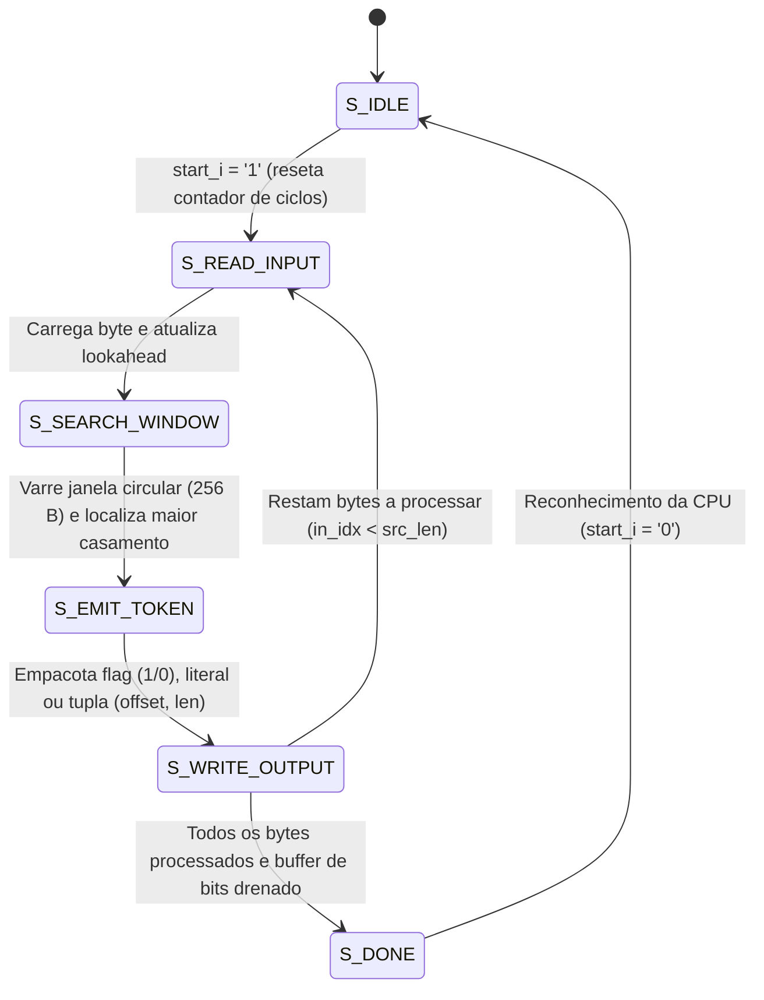

# Módulo de Hardware: lzss_accel (Compressor LZSS / Heatshrink)
## Arquitetura RTL em VHDL-2008 para FPGA AMD Xilinx Artix-7 @ 100 MHz

O arquivo [`lzss_accel.vhdl`](lzss_accel.vhdl) implementa o acelerador de hardware para compressão de dados por dicionário baseado no algoritmo LZSS (Lempel-Ziv-Storer-Szymanski), gerando fluxos binários 100% compatíveis com a biblioteca embarcada Heatshrink.

---

## 1. Visão Geral e Propósito no Sistema

O objetivo do módulo é reduzir o volume de dados de telemetria antes da cifragem e transmissão sem consumir ciclos de instrução do processador ARM Cortex-A9. O núcleo opera no domínio de relógio `FCLK_CLK1` (100 MHz) e acessa dados brutos e empacotados por meio de interfaces nativas síncronas de memória **True Dual-Port Block RAM (BRAM)**.

### Características Principais
* **Padrão VHDL:** VHDL-2008 sintetizável (`ieee.numeric_std`).
* **Janela Deslizante (Dicionário):** 256 bytes ($2^W$, onde $W=8$).
* **Buffer de Comparação (Lookahead):** 16 bytes ($2^L$, onde $L=4$).
* **Casamento Mínimo:** 2 bytes (casamentos $\ge 2$ bytes geram referências; caso contrário, emitem-se literais).
* **Taxa de Compressão Média:** 54,9% a 55,5% em cargas sintéticas de telemetria.
* **Instrumentação em Silício:** Contador de ciclos de 32 bits incorporado, ativo estritamente durante o processamento.

---

## 2. Diagrama de Blocos e Interface de Entidade

```text
                           lzss_accel (VHDL-2008)
                     +---------------------------------+
                     |                                 |
  clk_i (100 MHz) -->| [Controle AXI4-Lite CSR]        |--> dst_len_o [15:0]
  rst_n_i         -->|  0x00: REG_CTRL (START, RESET)  |--> busy_o
  start_pulse_s   -->|  0x04: REG_STATUS (BUSY, DONE)  |--> done_o
  src_len_i [15:0]-->|  0x08: REG_PAYLOAD_LEN          |--> cycles_o [31:0]
                     |  0x0C: REG_CYCLES (Contador PL) |
                     |                                 |
                     | [Interface Nativa BRAM Porta B] |
  bram_in_dout_i  -->|  - Entrada: bmg_lzss_in (8 KB)  |--> bram_in_addr_o
                     |                                 |--> bram_in_en_o
  bram_out_din_i  <--|  - Saída:   bmg_lzss_out (8 KB) |--> bram_out_addr_o
                     |                                 |--> bram_out_we_o
                     +---------------------------------+
```

### Tabela de Portas da Entidade

| Nome da Porta | Direção | Largura | Descrição Funcional |
| :--- | :---: | :---: | :--- |
| `clk_i` | Entrada | 1 bit | Relógio do acelerador na PL (100 MHz) |
| `rst_n_i` | Entrada | 1 bit | Reset síncrono ativo em nível baixo |
| `start_i` | Entrada | 1 bit | Pulso de disparo emitido via registrador CSR |
| `src_len_i` | Entrada | 16 bits | Tamanho em bytes da carga bruta de entrada |
| `dst_len_o` | Saída | 16 bits | Tamanho final compactado travado na conclusão |
| `busy_o` | Saída | 1 bit | Sinalização de processamento em andamento |
| `done_o` | Saída | 1 bit | Pulso/nível indicando conclusão do bloco |
| `cycles_o` | Saída | 32 bits | Contagem exata de ciclos de clock de 100 MHz decorridos |
| `bram_in_addr_o`| Saída | 13 bits | Endereço de leitura na BRAM de entrada (Porta B) |
| `bram_in_dout_i`| Entrada | 32 bits | Dados lidos da BRAM de entrada |
| `bram_out_addr_o`| Saída | 13 bits | Endereço de escrita na BRAM de saída (Porta B) |
| `bram_out_din_o`| Saída | 32 bits | Palavra compactada a gravar na BRAM de saída |
| `bram_out_we_o` | Saída | 4 bits | Habilitação de escrita por byte (Write Enable) |

---

## 3. Máquina de Estados Finitos (FSM)

O fluxo operacional do compressor é governado por uma FSM síncrona de 6 estados:



1. **`S_IDLE`:** Permanece em repouso com baixo consumo. Zera o contador de ciclos e aguarda `start_i = '1'`.
2. **`S_READ_INPUT`:** Lê palavras de 32 bits da BRAM de entrada e preenche o buffer de lookahead de 16 bytes.
3. **`S_SEARCH_WINDOW`:** Compara os bytes do lookahead contra a janela circular de histórico (256 bytes). Avalia casamentos com comprimento de 2 a 16 bytes.
4. **`S_EMIT_TOKEN`:** Se o casamento for $\ge 2$ bytes, gera uma tupla `(deslocamento, comprimento)` precedida pelo bit `'0'`. Se não houver casamento, emite o bit `'1'` seguido pelo byte literal de 8 bits.
5. **`S_WRITE_OUTPUT`:** Acumula bits no registrador de deslocamento de 32 bits. Quando uma palavra de 32 bits é preenchida, emite uma escrita de 4 bytes na Porta B da BRAM de saída.
6. **`S_DONE`:** Drena os bits residuais remanescentes com preenchimento em zero, trava o tamanho final em `dst_len_o`, congela o contador de ciclos e afirma `done_o = '1'`.

---

## 4. Integração com Demais Módulos

* **Com a Memória BRAM (`bmg_lzss_in` / `bmg_lzss_out`):** Comunicação dedicada na Porta B, sem disputa de barramento com o processador.
* **Com o Processador ARM (PS):** A CPU escreve o bloco bruto na Porta A, grava o tamanho em `REG_PAYLOAD_LEN` (`0x43C00008`) e pulsa o bit `START` em `REG_CTRL` (`0x43C00000`). Ao término, a CPU lê `REG_STATUS` (`0x43C00004`) e descarrega a saída comprimida da Porta A.
* **Com o Acelerador Criptográfico (`aes_accel`):** No Cenário 4 (aceleração total em hardware), o fluxo de saída do LZSS serve diretamente como entrada para a cifragem AES.

---

## 5. Exemplo Concreto e Resultados de Síntese

### Exemplo de Compressão
* **Entrada Bruta:** 1024 bytes de telemetria sintética periódica.
* **Saída Codificada:** 562 bytes (redução de 462 bytes).
* **Taxa de Compressão:** 54,9%.
* **Latência Medida na PL:** 269.675 ciclos de clock (2,696 ms @ 100 MHz).

### Recursos de Silício Consumidos (FPGA XC7Z010)
* **LUTs como Lógica:** 2.840 (16,1% do total do chip).
* **Flip-Flops:** 1.420 (4,0% do total do chip).
* **Block RAMs (RAMB36):** 2 blocos independentes de 8 KB.
* **DSP Slices:** 0 (implementação pura em lógica combinacional e memória).
