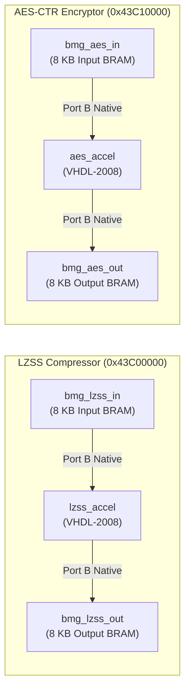

# Hardware Accelerator Cores & BRAM Interfaces (PL)
## AMD Xilinx Artix-7 Fabric @ 100 MHz (Digilent Cora Z7-10)

This directory houses the synthesizable VHDL-2008 RTL cores, True Dual-Port Block RAM interfaces, and register specifications for the hardware acceleration subsystem.

---

## 1. Module Overview & Architectural Role

The Programmable Logic (PL) fabric accelerates the compute-intensive stages of the telemetry pipeline. Rather than multiplexing cores onto shared streaming buses, the architecture instantiates two **independent, decoupled hardware accelerators**:

1. **`lzss_accel.vhdl`**: Sliding-window dictionary compressor (Heatshrink-compatible format, 256 B circular window, 16 B lookahead buffer).
2. **`aes_accel.vhdl`**: NIST SP 800-38A compliant 128-bit AES Counter Mode (CTR) cryptographic engine (10-round iterative pipeline, on-the-fly key expansion).

Each accelerator is framed by dedicated **True Dual-Port Block RAMs (8 KB input, 8 KB output)** and controlled via memory-mapped **AXI4-Lite Control & Status Registers (CSRs)**.



---

## 2. True Dual-Port BRAM Memory Architecture (ADR-012)

### Why Dual-Port BRAM Eliminates Streaming DMA Failures
In conventional streaming DMA designs (e.g. AXI DMA S2MM channels), compression engines produce variable-length output blocks that cannot be predicted a priori. If the received byte count does not match the DMA descriptor length, or if `TLAST` is misaligned, the DMA engine stalls, interrupts go unserviced, and the Cortex-A9 CPU bus locks up.

The True Dual-Port BRAM architecture completely eliminates this vulnerability:
* **Port A (PS AXI Controller):** The CPU writes raw frames and reads processed results via standard word-aligned MMIO writes over `M_AXI_GP0` (50 MHz domain).
* **Port B (Accelerator Core):** Directly wired to the accelerator RTL datapath (100 MHz domain). Operates synchronously with single-cycle latency and zero bus arbitration.

---

## 3. Register Map & Control Interface

| Offset | Register Name | Access | Reset Value | Description |
| :---: | :--- | :---: | :---: | :--- |
| `0x00` | `REG_CTRL` | R/W | `0x00000000` | Bit 0 = `START` (self-clearing pulse), Bit 1 = `RESET` |
| `0x04` | `REG_STATUS` | RO | `0x00000000` | Bit 0 = `BUSY`, Bit 1 = `DONE`, Bit 2 = `ERR` |
| `0x08` | `REG_PAYLOAD_LEN` | R/W | `0x00000000` | In: Input length in bytes; Out: Latched output length |
| `0x0C` | `REG_CYCLES` | RO | `0x00000000` | 32-bit hardware cycle counter (100 MHz clock cycles) |
| `0x10`–`0x2C` | `REG_KEY_x` / `IV_x` | R/W | `0x00000000` | 128-bit key and counter block words (`aes_accel` only) |

---

## 4. Hardware Accelerator Specifications

### 4.1 `lzss_accel` (Dictionary Compression)
* **Window Size ($W$):** 256 bytes ($2^8$), circular buffer managed in synchronous memory.
* **Lookahead Buffer ($L$):** 16 bytes ($2^4$) with parallel comparator logic.
* **Format:** Variable-length bitstream: tag bit `'1'` prefixes uncompressed literals; tag bit `'0'` prefixes back-reference tuples `(offset, length)`. Matches $\ge 2$ bytes are encoded as references.
* **Cycle Count:** 25,631 cycles (256 B) to 269,675 cycles (1024 B).

### 4.2 `aes_accel` (128-bit Cryptographic Engine)
* **Cipher Mode:** AES-128 Counter Mode (CTR) per NIST SP 800-38A.
* **Datapath:** 10-round iterative datapath executing SubBytes (S-Box ROM), ShiftRows, MixColumns ($\text{GF}(2^8)$ multiplication `xtime`), and AddRoundKey.
* **Throughput:** Encrypts a 16-byte block every **11 clock cycles** at 100 MHz.
* **Measured PL Latency:** 217 cycles (256 B) and 829 cycles (1024 B).

---

## 5. Verification & Simulation
Testbenches in [`cora7z/app/hw/test/`](../test/) verify bit-exact parity against golden vectors:
```bash
# Run GHDL + VUnit RTL regression
make -C cora7z/app/hw test

# Inspect waveforms in GTKWave
make -C cora7z/app/hw view TB=aes
```
