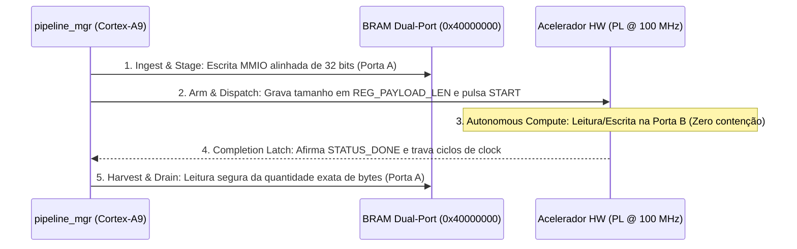

# Módulo de Software: pipeline_mgr (Gerenciador do Pipeline Híbrido)
## Driver de Orquestração Heterogênea para ARM Cortex-A9 (Bare-Metal C11)

Os arquivos [`pipeline_mgr.c`](pipeline_mgr.c) e [`pipeline_mgr.h`](pipeline_mgr.h) implementam o núcleo de co-projeto hardware/software do sistema, gerenciando a movimentação de dados entre a memória DDR3 e os aceleradores na lógica programável (PL).

---

## 1. Visão Geral e Responsabilidades

O gerenciador de pipeline atua como a camada de abstração de hardware (HAL) e controlador de fluxo para os quatro cenários avaliados:
1. **Controle de Cenários Operacionais:** Seleciona dinamicamente entre execução em software puro, aceleração parcial (compressão ou cifragem) ou aceleração total em hardware.
2. **Gerenciamento de BRAM Dual-Port (Estágio Store-and-Forward):** Executa cópias alinhadas de 32 bits entre buffers de DDR3 e os controladores AXI BRAM da PL (`0x40000000` e `0x40010000`).
3. **Controle de Registradores AXI4-Lite:** Dispara os aceleradores, programa comprimentos de carga e monitora as bandeiras de conclusão com temporizadores de guarda (*watchdogs*).
4. **Segurança de Barramento:** Verifica o bit 2 do registrador DEVCFG (`0xF800700C`, `PCFG_DONE`) antes de emitir acessos aos barramentos AXI para evitar travamentos do processador.
5. **Geração Segura de IV (SEC-01):** Vincula o identificador de sequência monotônico do pacote (`seq_id`) aos 64 bits superiores do IV do AES-CTR para impedir reutilização de keystream.

---

## 2. Definição dos Cenários de Avaliação

```c
typedef enum {
    SCENARIO_CASE1_SW_SW = 1, // Cenário 1: SW LZSS + SW AES-CTR (Linha de Base)
    SCENARIO_CASE2_HW_SW = 2, // Cenário 2: PL LZSS + SW AES-CTR (Offload Compressão)
    SCENARIO_CASE3_SW_HW = 3, // Cenário 3: SW LZSS + PL AES-CTR (Offload Cifragem - Ápice 1,56x)
    SCENARIO_CASE4_HW_HW = 4  // Cenário 4: PL LZSS + PL AES-CTR (Aceleração Total em Hardware)
} pipeline_scenario_t;
```

---

## 3. Protocolo Store-and-Forward com a BRAM Dual-Port

Para contornar falhas de travamento comuns em controladores DMA tradicionais quando confrontados com blocos comprimidos de comprimento variável, o driver implementa um contrato de 5 etapas determinísticas:



---

## 4. Endereçamento e Constantes de Hardware

```c
// Base Addresses dos Controladores AXI BRAM (Porta A - 50 MHz)
#define LZSS_BRAM_IN_BASE    0x40000000U
#define LZSS_BRAM_OUT_BASE   0x40002000U
#define AES_BRAM_IN_BASE     0x40010000U
#define AES_BRAM_OUT_BASE    0x40012000U

// Base Addresses dos Registradores CSR dos Aceleradores (AXI4-Lite)
#define LZSS_ACCEL_BASE      0x43C00000U
#define AES_ACCEL_BASE       0x43C10000U

// Offsets de Registradores Padronizados
#define REG_CTRL             0x00U  // Bit 0: START, Bit 1: RESET
#define REG_STATUS           0x04U  // Bit 0: BUSY,  Bit 1: DONE, Bit 2: ERR
#define REG_PAYLOAD_LEN      0x08U  // Comprimento da carga útil em bytes
#define REG_CYCLES           0x0CU  // Contador de ciclos de hardware na PL
```
