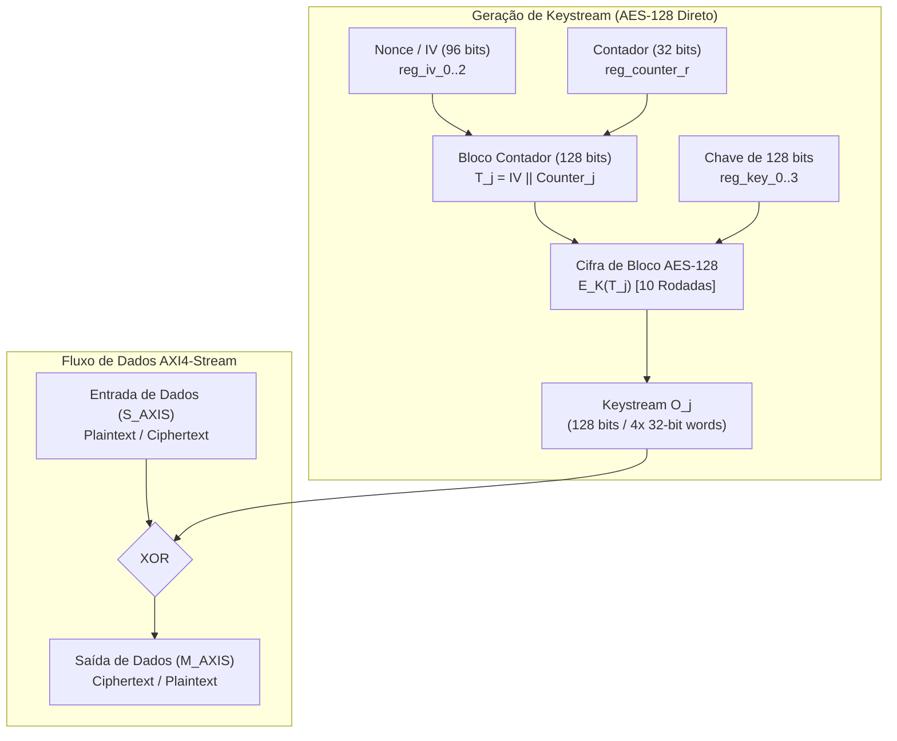

# Arquitetura e Implementação do Coprocessador Criptográfico AES-128-CTR em VHDL

**Projeto:** Aceleração Heterogênea de Compressão e Criptografia em SoC Zynq-7010 (Digilent Cora Z7-10)  
**Módulo:** `aes_ctr_engine.vhdl`  
**Autor:** Luis H. R. M. C. / Antigravity AI  
**Data:** 18 de Outubro de 2026  
**Padrão:** VHDL-2008 (IEEE 1076-2008)  
**Especificações:** NIST FIPS-197 / NIST SP 800-38A  

---

## 1. Fundamentos Teóricos do Algoritmo AES (FIPS-197)

O **Advanced Encryption Standard (AES)** é uma cifra de bloco simétrica adotada pelo National Institute of Standards and Technology (NIST) em 2001. A versão implementada opera com blocos de dados de **128 bits** e chave simétrica de **128 bits**, exigindo **10 rodadas ($N_r = 10$)** de transformações matemáticas sucessivas sobre uma matriz de estado de $4 \times 4$ bytes.

### 1.1 Representação da Matriz de Estado

O bloco de 128 bits (16 bytes) é mapeado em uma matriz bidimensional em ordem *column-major*:

$$\text{State} = \begin{bmatrix} s_{0,0} & s_{0,1} & s_{0,2} & s_{0,3} \\ s_{1,0} & s_{1,1} & s_{1,2} & s_{1,3} \\ s_{2,0} & s_{2,1} & s_{2,2} & s_{2,3} \\ s_{3,0} & s_{3,1} & s_{3,2} & s_{3,3} \end{bmatrix} = \begin{bmatrix} b_0 & b_4 & b_8 & b_{12} \\ b_1 & b_5 & b_9 & b_{13} \\ b_2 & b_6 & b_{10} & b_{14} \\ b_3 & b_7 & b_{11} & b_{15} \end{bmatrix}$$

### 1.2 Transformações Fundamentais de Cada Rodada

A cada rodada do algoritmo, quatro transformações são aplicadas:

1. **`SubBytes` (Substituição Não-Linear de Bytes)**:
   - Cada byte do estado $s_{r,c}$ é substituído de forma independente pelo valor correspondente em uma tabela de busca de 256 bytes denominada **S-Box**.
   - A S-Box é construída calculando o inverso multiplicativo no corpo finito de Galois $GF(2^8)$ com polinômio irredutível $m(x) = x^8 + x^4 + x^3 + x + 1$ (`0x11B`), seguido de uma transformação afim invertível sobre $GF(2)$.
   - Em hardware, 16 S-Boxes combinacionais operam em paralelo para transformar o bloco completo em um único ciclo.

2. **`ShiftRows` (Permutação Cíclica de Linhas)**:
   - Linha 0: sem deslocamento.
   - Linha 1: deslocamento circular à esquerda de 1 byte ($s_{1,c} \leftarrow s_{1,(c+1)\bmod 4}$).
   - Linha 2: deslocamento circular à esquerda de 2 bytes ($s_{2,c} \leftarrow s_{2,(c+2)\bmod 4}$).
   - Linha 3: deslocamento circular à esquerda de 3 bytes ($s_{3,c} \leftarrow s_{3,(c+3)\bmod 4}$).
   - Em hardware FPGA, essa operação não consome lógica (apenas fiação direta entre registradores).

3. **`MixColumns` (Difusão Linear nas Colunas)**:
   - Cada coluna da matriz de estado é multiplicada por uma matriz circulant fixa de Maximum Distance Separable (MDS) no corpo $GF(2^8)$:
     $$\begin{bmatrix} s'_{0,c} \\ s'_{1,c} \\ s'_{2,c} \\ s'_{3,c} \end{bmatrix} = \begin{bmatrix} 02 & 03 & 01 & 01 \\ 01 & 02 & 03 & 01 \\ 01 & 01 & 02 & 03 \\ 03 & 01 & 01 & 02 \end{bmatrix} \begin{bmatrix} s_{0,c} \\ s_{1,c} \\ s_{2,c} \\ s_{3,c} \end{bmatrix}$$
   - A multiplicação por 02 é realizada pela função $xtime(b)$:
     $$xtime(b) = (b \ll 1) \oplus (0x1B \text{ se } b_7 = 1 \text{ senão } 0x00)$$
   - A multiplicação por 03 é calculada como $xtime(b) \oplus b$.
   - **Nota**: A transformação `MixColumns` é omitida na última rodada (Rodada 10).

4. **`AddRoundKey` (Injeção da Chave da Rodada)**:
   - Os 128 bits do estado são combinados por operação XOR bit-a-bit com os 128 bits da subchave correspondente à rodada:
     $$\text{State}' = \text{State} \oplus K_r$$

### 1.3 Expansão de Chave (*Key Schedule*)

A chave do usuário de 128 bits ($K$) é expandida em um array linear de 44 palavras de 32 bits ($W_0, W_1, \dots, W_{43}$), fornecendo 11 subchaves de 128 bits:
- $W_0, W_1, W_2, W_3$: Chave original.
- Para $i = 4$ até 43:
  $$W_i = \begin{cases} W_{i-4} \oplus \text{SubWord}(\text{RotWord}(W_{i-1})) \oplus \text{Rcon}[i/4], & \text{se } i \equiv 0 \pmod 4 \\ W_{i-4} \oplus W_{i-1}, & \text{caso contrário} \end{cases}$$
Onde $\text{Rcon}[j]$ é a constante de rodada $x^{j-1}$ em $GF(2^8)$.

---

## 2. Princípio do Modo Contador (AES-CTR - NIST SP 800-38A)

O **Counter Mode (CTR)** converte uma cifra de bloco em uma cifra de fluxo (*stream cipher*), gerando uma sequência pseudoaleatória de bytes (*keystream*) independente do texto plano:



### 2.1 Propriedades Notáveis do Modo CTR

1. **Simetria Operacional**: A cifragem e a decifragem executam exatamente a mesma operação:
   $$C_j = P_j \oplus E_K(T_j) \iff P_j = C_j \oplus E_K(T_j)$$
   Como a operação de decifração nunca invoca a decifração da cifra de bloco ($D_K$), **não há necessidade de implementar a S-Box inversa nem o MixColumns inverso em silício**, economizando mais de 50% dos recursos de hardware na FPGA.
2. **Sem Propagação de Erros**: A corrupção de 1 bit no texto cifrado corrompe exatamente 1 bit no texto plano decifrado, sem corromper os blocos adjacentes.
3. **Alto Throughput**: O keystream pode ser pré-computado em paralelo com a chegada dos dados.

---

## 3. Arquitetura do Coprocessador e Integração de Memória no Block Design (ADR-012)

Em conformidade com a diretriz arquitetural **ADR-012**, o módulo `aes_ctr_engine` não aloca arrays gigantescos de memória interna. A entidade é puramente computacional e modular:

- **Controle e Configuração**: Barramento escravo **AXI4-Lite** em `0x43C20000` (`s_axi_lite_awaddr`, `s_axi_lite_wdata`, etc.).
- **Fluxo de Dados**: Interfaces padronizadas **AXI4-Stream** de 32 bits:
  - Ingress: `s_axis_tdata(31:0)`, `s_axis_tvalid`, `s_axis_tready`, `s_axis_tlast`, `s_axis_tkeep(3:0)`.
  - Egress: `m_axis_tdata(31:0)`, `m_axis_tvalid`, `m_axis_tready`, `m_axis_tlast`, `m_axis_tkeep(3:0)`.
- **Memória Desacoplada no Block Design**:
  - Na tela do Vivado Block Design (`soc_final_bd_1.bd`), os blocos **`axis_data_fifo`** da Xilinx são conectados na entrada e na saída do coprocessador, absorvendo as latências de transferência e fornecendo buffer visual para o AXI DMA.

```
+-----------------------------------------------------------------------------------------+
|                                  VIVADO BLOCK DESIGN                                    |
|                                                                                         |
|  [AXI DMA MM2S] ===> [axis_data_fifo_in] ===> [aes_ctr_engine] ===> [axis_data_fifo_out] ===> [AXI DMA S2MM]
|                                                     ^                                   |
|  [PS7 M_AXI_GP0] ===================================+ (AXI4-Lite @ 0x43C20000)          |
+-----------------------------------------------------------------------------------------+
```

---

## 4. Máquina de Estados Finita (FSM) do Coprocessador

A máquina de estados implementada em [`aes_ctr_engine.vhdl`](file:///home/luis/ufmg/soc/proj/cora7z/app/hw/src/aes_ctr_engine.vhdl) opera nos seguintes estados:

1. **`ST_IDLE`**: Repouso com `s_axis_tready = '0'` e `m_axis_tvalid = '0'`. Aguarda pulso no bit 0 do registrador `CONTROL` (`START`).
2. **`ST_EXPAND_KEYS`**: Expande a chave de 128 bits (`KEY_0..3`) em 11 subchaves de 128 bits ($W_0..W_{43}$) armazenadas em registradores internos dedicados.
3. **`ST_LOAD_CTR`**: Monta o bloco contador inicial $T_j = [\text{IV\_0}, \text{IV\_1}, \text{IV\_2}, \text{cur\_counter\_r}]$ e aplica o `AddRoundKey` inicial (Rodada 0).
4. **`ST_ROUND_OP`**: Itera sequencialmente pelas rodadas 1 a 10 (1 ciclo por rodada). Ao atingir a rodada 10, o keystream de 128 bits está pronto e é armazenado em `keystream_r`.
5. **`ST_STREAM_XOR`**: Transfere 4 palavras de 32 bits via AXI4-Stream. A cada batida com handshake (`tvalid and tready`), realiza a operação XOR entre a palavra de dados e a palavra de keystream correspondente.
6. **`ST_NEXT_BLOCK`**: Incrementa o contador de 32 bits ($\text{cur\_counter\_r} \leftarrow \text{cur\_counter\_r} + 1$) e retorna a `ST_LOAD_CTR` caso ainda existam dados a processar.
7. **`ST_DONE`**: Finaliza o processamento, asserta o bit 1 em `STATUS` (`DONE`), grava `DST_LEN` e dispara pulso na linha de interrupção `irq_o`.

---

## 5. Validação contra Vetores Oficiais NIST SP 800-38A

O banco de testes em VUnit ([`tb_aes_ctr_engine.vhdl`](file:///home/luis/ufmg/soc/proj/cora7z/app/hw/test/tb_aes_ctr_engine.vhdl)) valida o núcleo com os vetores oficiais publicados pelo NIST:

- **Chave de Cifragem ($K$)**:  
  `2b7e1516 28aed2a6 abf71588 09cf4f3c`
- **Vetor de Inicialização / Nonce ($IV$)**:  
  `f0f1f2f3 f4f5f6f7 f8f9fa`
- **Texto Plano ($P_1$)**:  
  `6bc1bee2 2e409f96 e93d7e11 7393172a`
- **Texto Cifrado Esperado ($C_1$)**:  
  `874d6191 b620e326 1bef6864 990db6ce`

### Resumo dos Resultados do Testbench VUnit
```text
pass lib.tb_aes_ctr_engine.test_csr_access                 (0.3 seconds)
pass lib.tb_aes_ctr_engine.test_nist_sp800_38a_vector      (0.3 seconds)
pass lib.tb_aes_ctr_engine.test_backpressure               (0.3 seconds)
pass lib.tb_aes_ctr_engine.test_soft_reset                 (0.3 seconds)
=================================================================================
pass 4 of 4
=================================================================================
```

---

## 6. Referências

1. National Institute of Standards and Technology (NIST), *FIPS PUB 197: Advanced Encryption Standard (AES)*, 2001.
2. National Institute of Standards and Technology (NIST), *SP 800-38A: Recommendation for Block Cipher Modes of Operation: Methods and Techniques*, 2001.
3. Daemen, J., Rijmen, V., *The Design of Rijndael: AES - The Advanced Encryption Standard*, Springer-Verlag, 2002.
4. IEEE Standard VHDL Language Reference Manual, *IEEE Std 1076-2008*, 2009.
