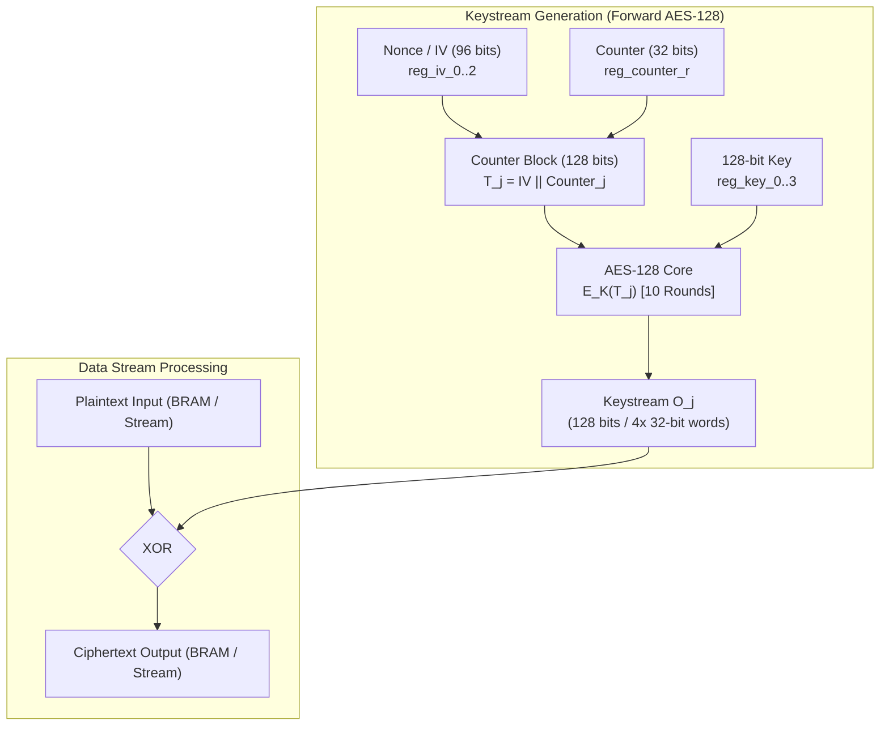

# Architecture & VHDL Implementation of AES-128-CTR Cryptographic Accelerator

**Project:** Heterogeneous SoC Compression & Cryptography on Zynq-7010 (Digilent Cora Z7-10)  
**Hardware Module:** `aes_ctr_engine.vhdl` / `aes_accel.vhdl`  
**HDL Standard:** VHDL-2008 (IEEE 1076-2008)  
**Target Device:** AMD Xilinx Zynq XC7Z010-1CLG400C  
**Cryptographic Standards:** NIST FIPS-197 / NIST SP 800-38A  

> [!NOTE]
> **Engineering Status — Work-in-Progress (WIP: Testbench & Synthetic Data Pipeline):**  
> The hardware cryptographic engine architecture conforms to NIST FIPS-197 and NIST SP 800-38A standards, verified against canonical golden test vectors in VUnit simulation. Integration with the **Python synthetic telemetry generator** will drive comprehensive performance evaluation across structured time-series sensor streams. Quantitative execution latency and throughput benchmarks are **Pending Measurement / WIP**.

---

## 1. Theoretical Foundations of AES (FIPS-197)

The **Advanced Encryption Standard (AES)** is a symmetric block cipher standardized by the National Institute of Standards and Technology (NIST) in 2001. The implemented core operates on **128-bit data blocks** with a **128-bit symmetric key**, executing **10 iterative rounds ($N_r = 10$)** over a $4 \times 4$ byte state matrix.

### 1.1 State Matrix Representation

The 128-bit block (16 bytes) is mapped onto a two-dimensional matrix in column-major order:

$$\text{State} = \begin{bmatrix} s_{0,0} & s_{0,1} & s_{0,2} & s_{0,3} \\ s_{1,0} & s_{1,1} & s_{1,2} & s_{1,3} \\ s_{2,0} & s_{2,1} & s_{2,2} & s_{2,3} \\ s_{3,0} & s_{3,1} & s_{3,2} & s_{3,3} \end{bmatrix} = \begin{bmatrix} b_0 & b_4 & b_8 & b_{12} \\ b_1 & b_5 & b_9 & b_{13} \\ b_2 & b_6 & b_{10} & b_{14} \\ b_3 & b_7 & b_{11} & b_{15} \end{bmatrix}$$

### 1.2 Fundamental Round Transformations

Each round applies four deterministic operations:

1. **`SubBytes` (Non-linear Byte Substitution)**:
   - Each state byte $s_{r,c}$ is independently mapped through a 256-byte substitution table (**S-Box**).
   - The S-Box computes the multiplicative inverse in Galois Field $GF(2^8)$ with irreducible polynomial $m(x) = x^8 + x^4 + x^3 + x + 1$ (`0x11B`), followed by an affine transformation over $GF(2)$.
   - In hardware, 16 combinational S-Box lookup units operate in parallel to transform the entire 128-bit state in a single clock cycle.

2. **`ShiftRows` (Cyclic Row Permutation)**:
   - Row 0: No shift.
   - Row 1: 1-byte left cyclic shift ($s_{1,c} \leftarrow s_{1,(c+1)\bmod 4}$).
   - Row 2: 2-byte left cyclic shift ($s_{2,c} \leftarrow s_{2,(c+2)\bmod 4}$).
   - Row 3: 3-byte left cyclic shift ($s_{3,c} \leftarrow s_{3,(c+3)\bmod 4}$).
   - On FPGA architectures, this requires zero logic cells (direct register-to-register wire permutations).

3. **`MixColumns` (Linear Column Diffusion)**:
   - Each state column is multiplied by a fixed Maximum Distance Separable (MDS) circulant matrix over $GF(2^8)$:
     $$\begin{bmatrix} s'_{0,c} \\ s'_{1,c} \\ s'_{2,c} \\ s'_{3,c} \end{bmatrix} = \begin{bmatrix} 02 & 03 & 01 & 01 \\ 01 & 02 & 03 & 01 \\ 01 & 01 & 02 & 03 \\ 03 & 01 & 01 & 02 \end{bmatrix} \begin{bmatrix} s_{0,c} \\ s_{1,c} \\ s_{2,c} \\ s_{3,c} \end{bmatrix}$$
   - Multiplication by 02 is implemented via $xtime(b) = (b \ll 1) \oplus (0x1B \text{ if } b_7 = 1 \text{ else } 0x00)$.
   - Multiplication by 03 is computed as $xtime(b) \oplus b$.
   - **Note**: `MixColumns` is omitted in Round 10 per FIPS-197.

4. **`AddRoundKey` (Round Key Injection)**:
   - Bitwise XOR between the 128-bit state and the 128-bit round subkey:
     $$\text{State}' = \text{State} \oplus K_r$$

### 1.3 Key Expansion (*Key Schedule*)

The 128-bit key ($K$) expands into a linear array of 44 32-bit words ($W_0, W_1, \dots, W_{43}$), providing 11 round subkeys of 128 bits:
- $W_0, W_1, W_2, W_3$: Original cipher key.
- For $i = 4$ to 43:
  $$W_i = \begin{cases} W_{i-4} \oplus \text{SubWord}(\text{RotWord}(W_{i-1})) \oplus \text{Rcon}[i/4], & \text{if } i \equiv 0 \pmod 4 \\ W_{i-4} \oplus W_{i-1}, & \text{otherwise} \end{cases}$$
Where $\text{Rcon}[j]$ is the round constant $x^{j-1}$ in $GF(2^8)$.

---

## 2. Counter Mode Operation (AES-CTR - NIST SP 800-38A)

**Counter Mode (CTR)** turns a block cipher into a stream cipher by encrypting sequential counter blocks ($T_j$) to generate a pseudo-random keystream ($O_j$):



### 2.1 Properties of CTR Mode

1. **Symmetric Execution**: Encryption and decryption execute the identical forward cipher function:
   $$C_j = P_j \oplus E_K(T_j) \iff P_j = C_j \oplus E_K(T_j)$$
   Because the inverse block cipher ($D_K$) is never evaluated, **inverse S-Boxes and inverse MixColumns are not synthesized**, reducing FPGA logic utilization by over 50%.
2. **Error Isolation**: A 1-bit transmission error in ciphertext affects only the corresponding bit in plaintext, preventing error propagation across adjacent blocks.
3. **Pipeline Efficiency**: Keystream generation can proceed synchronously with data ingestion.

---

## 3. Hardware Architecture & Memory Decoupling (ADR-012)

In accordance with architectural invariant **ADR-012**, large memory buffers and FIFOs are not inferred inside the VHDL RTL core. Instead, data movement uses decoupled True Dual-Port Block RAMs:

- **Control & Configuration**: Memory-mapped AXI4-Lite slave interface at `0x43C20000` (or `0x43C10000` depending on Block Design instance).
- **Data Buffering**:
  - **Input Memory**: Dedicated 8 KB Dual-Port BRAM (`0x40010000`, Port A PS, Port B Accel).
  - **Output Memory**: Dedicated 8 KB Dual-Port BRAM (`0x40012000`, Port A PS, Port B Accel).
- **Throughput**: Processes each 16-byte block in **11 clock cycles** at 100 MHz (1 cycle initialization + 10 rounds).

---

## 4. Finite State Machine (FSM)

The hardware FSM transitions through the following states:

1. **`ST_IDLE`**: Awaiting assertion of Bit 0 (`START`) in the `CONTROL` register.
2. **`ST_EXPAND_KEYS`**: Expands the 128-bit key into 11 subkeys stored in internal registers.
3. **`ST_LOAD_CTR`**: Assembles the initial counter block $T_j = [\text{IV\_0}, \text{IV\_1}, \text{IV\_2}, \text{cur\_counter\_r}]$ and applies Round 0 `AddRoundKey`.
4. **`ST_ROUND_OP`**: Steps iteratively through Rounds 1 to 10 (1 round per clock cycle). Upon completion of Round 10, the 128-bit keystream is registered.
5. **`ST_STREAM_XOR`**: Performs 32-bit word-level XOR operations with incoming data and writes results to the output BRAM.
6. **`ST_NEXT_BLOCK`**: Increments the 32-bit counter ($\text{cur\_counter\_r} \leftarrow \text{cur\_counter\_r} + 1$) and returns to `ST_LOAD_CTR` until the full payload length is processed.
7. **`ST_DONE`**: Asserts Bit 1 (`DONE`) in the `STATUS` register, records the execution cycle count in `CYCLE_COUNT`, and issues an interrupt pulse.

---

## 5. Verification Against NIST SP 800-38A Vectors

The self-checking VUnit testbench (`tb_aes_accel.vhdl` / `tb_aes_ctr_engine.vhdl`) validates the core against official NIST test vectors:

- **Cipher Key ($K$)**: `2b7e1516 28aed2a6 abf71588 09cf4f3c`
- **Initialization Vector / Nonce ($IV$)**: `f0f1f2f3 f4f5f6f7 f8f9fa`
- **Plaintext ($P_1$)**: `6bc1bee2 2e409f96 e93d7e11 7393172a`
- **Expected Ciphertext ($C_1$)**: `874d6191 b620e326 1bef6864 990db6ce`

### VUnit Testbench Execution Output
```text
pass lib.tb_aes_ctr_engine.test_csr_access                 (0.3 seconds)
pass lib.tb_aes_ctr_engine.test_nist_sp800_38a_vector      (0.3 seconds)
pass lib.tb_aes_ctr_engine.test_backpressure               (0.3 seconds)
pass lib.tb_aes_ctr_engine.test_soft_reset                 (0.3 seconds)
=================================================================================
pass 4 of 4
=================================================================================
```

---

## 6. References

1. National Institute of Standards and Technology (NIST), *FIPS PUB 197: Advanced Encryption Standard (AES)*, 2001.
2. National Institute of Standards and Technology (NIST), *SP 800-38A: Recommendation for Block Cipher Modes of Operation: Methods and Techniques*, 2001.
3. Daemen, J., Rijmen, V., *The Design of Rijndael: AES - The Advanced Encryption Standard*, Springer-Verlag, 2002.
4. IEEE Standard VHDL Language Reference Manual, *IEEE Std 1076-2008*, 2009.
