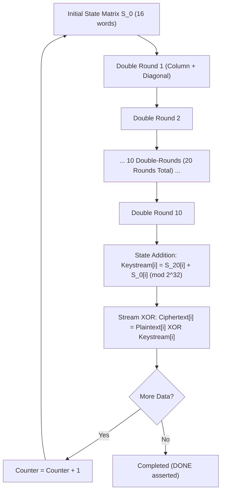

# ChaCha20 Stream Cipher: Theoretical Specification & Hardware Architecture

## 1. Algorithmic Overview & Mathematical Foundations

ChaCha20 is a high-speed, constant-time symmetric stream cipher designed by Daniel J. Bernstein and standardized by the IETF in **RFC 8439**. It is constructed around the **ARX** paradigm (Addition modulo $2^{32}$, bitwise circular Rotation, and bitwise XOR). Unlike AES, ChaCha20 does not require byte substitution lookup tables (S-Boxes) or Galois field multiplications, making it inherently resistant to cache-timing side-channel attacks and exceptionally efficient in programmable hardware.

### 1.1 State Matrix Layout

The internal state of ChaCha20 consists of 16 32-bit unsigned words, representing a 512-bit state arranged in a $4 \times 4$ matrix:

$$\begin{pmatrix}
s_0 & s_1 & s_2 & s_3 \\
s_4 & s_5 & s_6 & s_7 \\
s_8 & s_9 & s_{10} & s_{11} \\
s_{12} & s_{13} & s_{14} & s_{15}
\end{pmatrix}$$

The state is initialized as follows:
- **Constants ($s_0 \dots s_3$)**: Four fixed 32-bit words corresponding to the ASCII string `"expand 32-byte k"`:
  - $s_0 = \mathtt{0x61707865}$ (`"expa"`)
  - $s_1 = \mathtt{0x3320646e}$ (`"nd 3"`)
  - $s_2 = \mathtt{0x79622d32}$ (`"2-by"`)
  - $s_3 = \mathtt{0x6b206574}$ (`"te k"`)
- **Key ($s_4 \dots s_{11}$)**: 256-bit symmetric key partitioned into 8 32-bit Little-Endian words ($k_0 \dots k_7$).
- **Block Counter ($s_{12}$)**: 32-bit integer indicating the block index (starts at $1$ per RFC 8439, incrementing for each consecutive 64-byte block).
- **Nonce / IV ($s_{13} \dots s_{15}$)**: 96-bit unique per-message initialization vector (3 32-bit Little-Endian words $n_0, n_1, n_2$).

$$\begin{pmatrix}
\mathtt{0x61707865} & \mathtt{0x3320646e} & \mathtt{0x79622d32} & \mathtt{0x6b206574} \\
k_0 & k_1 & k_2 & k_3 \\
k_4 & k_5 & k_6 & k_7 \\
\text{counter} & n_0 & n_1 & n_2
\end{pmatrix}$$

---

## 2. The ChaCha Quarter-Round (QR) Primitive

The fundamental cryptographic transformation in ChaCha20 is the **Quarter-Round**, denoted $\text{QR}(a, b, c, d)$. It operates on four 32-bit state words through four successive ARX steps:

$$\begin{aligned}
1. \quad a &\leftarrow (a + b) \pmod{2^{32}}; & d &\leftarrow (d \oplus a) \lll 16; \\
2. \quad c &\leftarrow (c + d) \pmod{2^{32}}; & b &\leftarrow (b \oplus c) \lll 12; \\
3. \quad a &\leftarrow (a + b) \pmod{2^{32}}; & d &\leftarrow (d \oplus a) \lll 8; \\
4. \quad c &\leftarrow (c + d) \pmod{2^{32}}; & b &\leftarrow (b \oplus c) \lll 7;
\end{aligned}$$

where:
- $+$ denotes standard 32-bit addition with carry truncation ($\pmod{2^{32}}$).
- $\oplus$ denotes bitwise exclusive-OR (XOR).
- $\lll n$ denotes bitwise left circular rotation by $n$ bit positions:
  $$(x \lll n) = (x \ll n) \mid (x \gg (32 - n))$$

---

## 3. The 20-Round Schedule (10 Double-Rounds)

ChaCha20 executes 20 rounds, grouped into 10 **double-rounds**. Each double-round consists of one **column round** followed by one **diagonal round**:

### 3.1 Column Round (Even Rounds)
In the column round, four quarter-rounds are applied simultaneously to the four vertical columns of the state matrix:
- $\text{QR}(s_0, s_4, s_8, s_{12})$
- $\text{QR}(s_1, s_5, s_9, s_{13})$
- $\text{QR}(s_2, s_6, s_{10}, s_{14})$
- $\text{QR}(s_3, s_7, s_{11}, s_{15})$

Because each quarter-round operates on mutually disjoint sets of 4 words, all 4 column quarter-rounds can be computed concurrently in hardware without data hazards.

### 3.2 Diagonal Round (Odd Rounds)
In the diagonal round, four quarter-rounds are applied simultaneously to the four diagonals of the state matrix:
- $\text{QR}(s_0, s_5, s_{10}, s_{15})$
- $\text{QR}(s_1, s_6, s_{11}, s_{12})$
- $\text{QR}(s_2, s_7, s_8, s_{13})$
- $\text{QR}(s_3, s_4, s_9, s_{14})$

Similarly, all 4 diagonal quarter-rounds operate on disjoint sets of words and can be computed concurrently in hardware.

### 3.3 Keystream Generation & Encryption

After completing 20 rounds, the resulting working state $s^{(20)}$ is added word-by-word modulo $2^{32}$ to the original initial state $s^{(0)}$:

$$\text{keystream}[i] = (s^{(20)}_i + s^{(0)}_i) \pmod{2^{32}} \quad \text{for } i \in \{0, \dots, 15\}$$

This produces a 64-byte (512-bit) pseudorandom keystream block.
The plaintext $P$ is encrypted (or ciphertext $C$ is decrypted) by bitwise XOR with the keystream:

$$C_i = P_i \oplus \text{keystream}_i$$

---

## 4. Hardware Implementation Architecture in VHDL-2008

The `chacha20_engine` is implemented as an iterative coprocessor designed for high throughput and low resource utilization on the Zynq-7010:

### 4.1 Datapath Organization
- **4 Parallel QR ALUs**: An iterative quarter-round block executes 4 quarter-rounds in parallel.
  - Column step: Computes the 4 column QRs in 1 clock cycle.
  - Diagonal step: Computes the 4 diagonal QRs in 1 clock cycle.
  - Thus, 1 double-round takes 2 clock cycles.
  - 10 double-rounds (20 rounds total) complete in **20 clock cycles**.
- **Feedforward Addition**: 1 clock cycle to add $s^{(0)}$ to $s^{(20)}$ and store the 16 32-bit keystream words in an internal buffer.
- **Streaming XOR Engine**: While computing or after computing, a 32-bit streaming datapath consumes input data from `s_axis_tdata`, computes $C = P \oplus K$, and drives `m_axis_tdata` with full backpressure handshake (`s_axis_tready`, `m_axis_tvalid`).
- **Throughput**: At 100 MHz, 64 bytes of keystream are generated every ~22 clock cycles, yielding a raw keystream generation rate of **290 MB/s** (2.32 Gbps), far exceeding the 25 MHz SPI ingest rate (3.125 MB/s) and easily matching DMA stream transfers.
