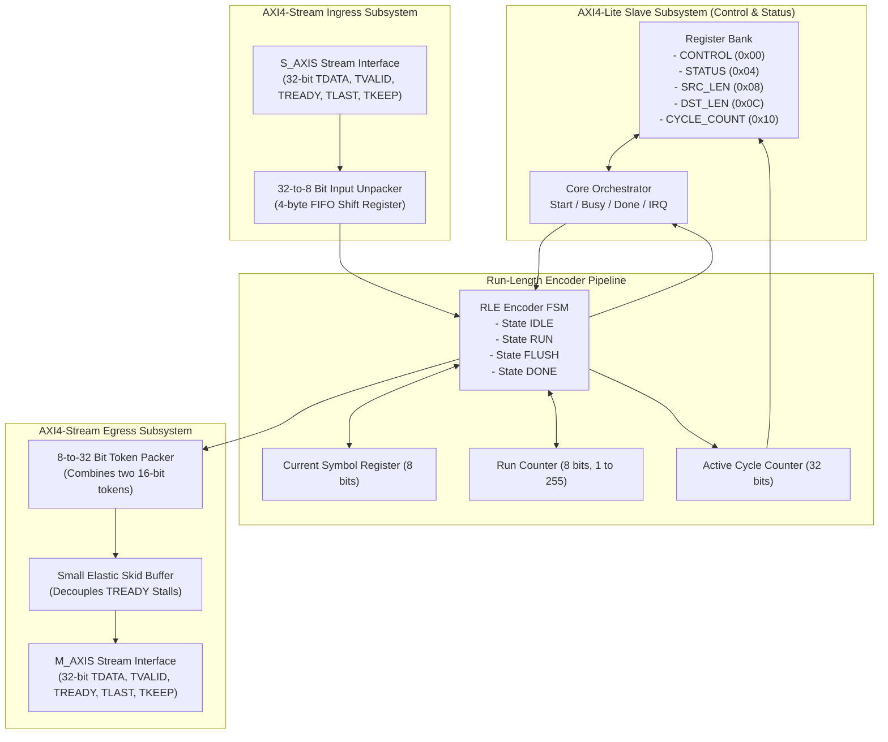

# Run-Length Encoding (RLE) Compression: Theory, Architecture, and VHDL Implementation

This document provides a comprehensive theoretical and architectural specification of the Run-Length Encoding (RLE) hardware accelerator (`rle_engine.vhdl`) implemented for the Digilent Cora Z7-10 (Xilinx Zynq-7010). It details the mathematical foundations of lossless compression, token formatting, finite-state machine (FSM) sequencing, AXI4-Lite control, and AXI4-Stream data movement.

---

## 1. Theoretical Principles of Lossless Compression

### 1.1 Information Theory and Shannon Entropy
Lossless data compression algorithms reduce the physical representation size of a message without discarding any information. Claude Shannon's source coding theorem establishes that the fundamental limit of lossless data compression for an independent and identically distributed (i.i.d.) discrete source $X$ is governed by its **Shannon Entropy** $H(X)$:

$$H(X) = - \sum_{i=1}^{n} P(x_i) \log_2 P(x_i) \quad \text{[bits/symbol]}$$

Where:
- $n$ is the alphabet size (for an 8-bit byte alphabet, $n = 256$).
- $P(x_i)$ is the empirical probability of occurrence of the $i$-th byte value $x_i$.

- **High-Entropy Data ($H(X) \approx 8$ bits/byte)**: In truly random or encrypted data, all 256 byte values appear with equal probability ($P(x_i) = \frac{1}{256}$). Here, $H(X) = 8.0$ bits/byte, meaning the data contains zero redundancy and cannot be compressed losslessly by any algorithm.
- **Low-Entropy Data ($H(X) \ll 8$ bits/byte)**: In structured or redundant data (such as repetitive sensor telemetry or solid raster runs), a small subset of symbols dominates, creating statistical and temporal redundancy that compression algorithms exploit.

### 1.2 The Run-Length Encoding (RLE) Algorithm
Run-Length Encoding is one of the most hardware-efficient lossless data compression techniques. Rather than building complex dynamic dictionaries (like LZ4 or LZW) or Huffman prefix trees, RLE exploits **spatial/temporal correlation**: consecutive runs of identical symbols are replaced by a single count and the symbol itself.

Given an input string of $N$ bytes:
$$\mathbf{S} = \underbrace{A, A, A, \dots, A}_{k_1 \text{ times}}, \underbrace{B, B, \dots, B}_{k_2 \text{ times}}, \dots$$

The RLE encoder transforms this into a sequence of tuples:
$$\mathbf{C} = (k_1, A), (k_2, B), \dots$$

Where:
- $k_i$ is the **run length** (number of consecutive identical bytes).
- $A, B$ are the **literal symbols**.

### 1.3 Compression Ratio and Boundary Behavior
The performance of the algorithm is measured by the **Compression Ratio ($CR$)** and the **Space Savings ($SS$)**:

$$CR = \frac{\text{Uncompressed Size (Bytes)}}{\text{Compressed Size (Bytes)}} = \frac{L_{\text{raw}}}{L_{\text{comp}}}$$

$$SS = \left( 1 - \frac{L_{\text{comp}}}{L_{\text{raw}}} \right) \times 100\%$$

- **Best-Case Scenario (Maximum Redundancy)**:
  A continuous block of 64 identical bytes:
  $$\mathbf{S}_{\text{best}} = \underbrace{0x41, 0x41, \dots, 0x41}_{64 \text{ bytes}} \longrightarrow \mathbf{C}_{\text{best}} = [64, 0x41] \quad (2 \text{ bytes})$$
  $$CR = \frac{64}{2} = 32.0:1 \quad (SS = 96.88\%)$$
- **Worst-Case Scenario (Zero Redundancy / Alternating Bytes)**:
  A continuous block of non-repeating bytes:
  $$\mathbf{S}_{\text{worst}} = 0x01, 0x02, 0x03, \dots \longrightarrow [1, 0x01], [1, 0x02], [1, 0x03], \dots$$
  Every input byte requires a 2-byte token, resulting in data expansion:
  $$CR = \frac{1}{2} = 0.5:1 \quad (SS = -100\%)$$

This dichotomy makes RLE the ideal reference baseline in our benchmark matrix to compare against LZ4 across redundant, pseudo-random, and telemetry workloads.

---

## 2. Token Framing and Data Representation

### 2.1 The 2-Byte Compressed Token Format
The hardware core implements a deterministic, word-aligned **Byte-Pair Token Scheme**:
Each run is serialized into a 16-bit little-endian tuple:

```
Token (16 bits):
┌───────────────────────────┬───────────────────────────┐
│ Byte 1: SYMBOL (Bits 15:8)│ Byte 0: COUNT (Bits 7:0)  │
└───────────────────────────┴───────────────────────────┘
```

1. **`COUNT` (Bits 7:0)**: An 8-bit unsigned integer representing the run length ($1 \le k \le 255$).
2. **`SYMBOL` (Bits 15:8)**: The literal 8-bit byte value that was repeated.

### 2.2 Maximum Run Saturation ($k > 255$)
Because the `COUNT` field is 8 bits wide, the maximum run that can be encoded in a single token is $k_{\max} = 255$.
When a continuous run exceeds 255 identical bytes:
1. The hardware immediately emits a saturated token: `[255, SYMBOL]`.
2. The internal run counter resets to 1.
3. Accumulation continues seamlessly for subsequent occurrences of that symbol.

For example, a run of 300 identical bytes `0xFF` is encoded as:
$$\mathbf{S} = [300 \times 0xFF] \longrightarrow \mathbf{C} = [255, 0xFF], [45, 0xFF]$$

### 2.3 32-Bit AXI-Stream Word Packing
In our Zynq-7010 SoC architecture, the AXI DMA (`axi_dma_0`) streams data in **32-bit words** (`TDATA[31:0]`).
The `rle_engine` hardware incorporates:
- **Input Unpacker**: Deserializes each incoming 32-bit beat from `s_axis_tdata` into 4 sequential bytes.
- **Output Packer**: Serializes 16-bit tokens `[COUNT, SYMBOL]` into 32-bit beats for `m_axis_tdata` (2 tokens per 32-bit beat).
- **Residual Flusher (`TKEEP` & `TLAST`)**: When the input stream asserts `s_axis_tlast`, any remaining active run is flushed into the packing buffer. If only one 16-bit token occupies the final 32-bit word, `m_axis_tkeep` is driven with `4'b0011` (`0x3`) and `m_axis_tlast` is asserted.

---

## 3. Hardware Architecture and Datapath

The core consists of four modular subsystems interconnected synchronously within the 100 MHz clock domain:



### 3.1 Finite State Machine (FSM) Specification
The compression datapath is governed by a synchronous 4-state Mealy/Moore hybrid FSM:

1. **`ST_IDLE`**:
   - The engine awaits the `START` command via AXI4-Lite or automatic streaming arming.
   - Clears `CYCLE_COUNT`, resets `DST_LEN`, and holds `m_axis_tvalid = '0'`.
   - Transitions to `ST_ACTIVE` upon arming.
2. **`ST_ACTIVE`**:
   - Consumes incoming bytes from the input unpacker when `s_axis_tvalid = '1'`.
   - **First Byte**: Stored into `run_symbol_r`, with `run_count_r <= 1`.
   - **Matching Byte (`curr_byte = run_symbol_r`)**:
     - If `run_count_r < 255`: Increments `run_count_r <= run_count_r + 1`.
     - If `run_count_r = 255`: Emits token `[255, run_symbol_r]`, and resets `run_count_r <= 1`.
   - **Mismatched Byte (`curr_byte /= run_symbol_r`)**:
     - Emits token `[run_count_r, run_symbol_r]`.
     - Updates `run_symbol_r <= curr_byte` and `run_count_r <= 1`.
   - **End of Stream (`s_axis_tlast = '1'`)**:
     - Consumes final byte, processes it, and transitions to `ST_FLUSH`.
3. **`ST_FLUSH`**:
   - Emits the pending `[run_count_r, run_symbol_r]` token.
   - Signals the token packer to complete the current 32-bit word, sets `m_axis_tlast = '1'`, and sets appropriate `m_axis_tkeep`.
   - Transitions to `ST_DONE`.
4. **`ST_DONE`**:
   - Latches total output byte length into `DST_LEN`.
   - Asserts `STATUS[1] (DONE)` and generates single-cycle pulse on `irq_o`.
   - Transitions back to `ST_IDLE` when `START` is cleared or next frame arrives.

---

## 4. Register Architecture (AXI4-Lite)

The accelerator exposes a standard 32-bit register bank at base address `0x43C00000` (clocked by `aclk` @ 100 MHz):

| Offset | Name | Access | Reset Value | Bit-Level Description |
|---|---|---|---|---|
| `0x00` | `CONTROL` | R/W | `0x00000000` | • **Bit 0**: `START` (Pulse 1 to arm accelerator)<br>• **Bit 1**: `RESET_CORE` (Synchronous soft reset)<br>• **Bit 2**: `IRQ_EN` (1 = generate interrupt pulse on completion) |
| `0x04` | `STATUS` | RO | `0x00000000` | • **Bit 0**: `BUSY` (1 while processing stream)<br>• **Bit 1**: `DONE` (1 when compression finishes)<br>• **Bit 2**: `ERR` (1 on FIFO overflow or invalid framing) |
| `0x08` | `SRC_LEN` | R/W | `0x00000000` | Expected uncompressed block length in bytes (optional sanity check). |
| `0x0C` | `DST_LEN` | RO | `0x00000000` | Exact compressed output length produced in bytes. |
| `0x10` | `CYCLE_COUNT` | RO | `0x00000000` | Hardware latency: number of active 100 MHz clock cycles consumed during processing. |

---

## 5. Verification Strategy and VUnit Test Plan

The VUnit testbench (`tb_rle_engine.vhdl`) validates the core against 6 comprehensive test scenarios:

1. **`test_csr_access`**: Verifies that AXI4-Lite read/write cycles correctly configure `CONTROL`, `SRC_LEN`, and read back `STATUS`.
2. **`test_single_byte_run`**: Tests edge case of a 1-byte packet `[0x42]` $\rightarrow$ encodes to `[0x01, 0x42]`.
3. **`test_high_redundancy_64b`**: Transmits 64 identical bytes `0xAA` $\rightarrow$ verifies compression to a single 2-byte token `[64, 0xAA]` packed with `tlast` asserted.
4. **`test_run_overflow_300b`**: Transmits 300 identical bytes `0x55` $\rightarrow$ verifies split into two tokens: `[255, 0x55]` followed by `[45, 0x55]`.
5. **`test_alternating_pattern`**: Transmits 16 distinct bytes $\rightarrow$ verifies correct expansion to 32 bytes with all counts equal to 1.
6. **`test_backpressure_stalls`**: Holds `m_axis_tready = '0'` randomly during streaming to verify that the internal skid buffer halts pipeline without losing data beats.
