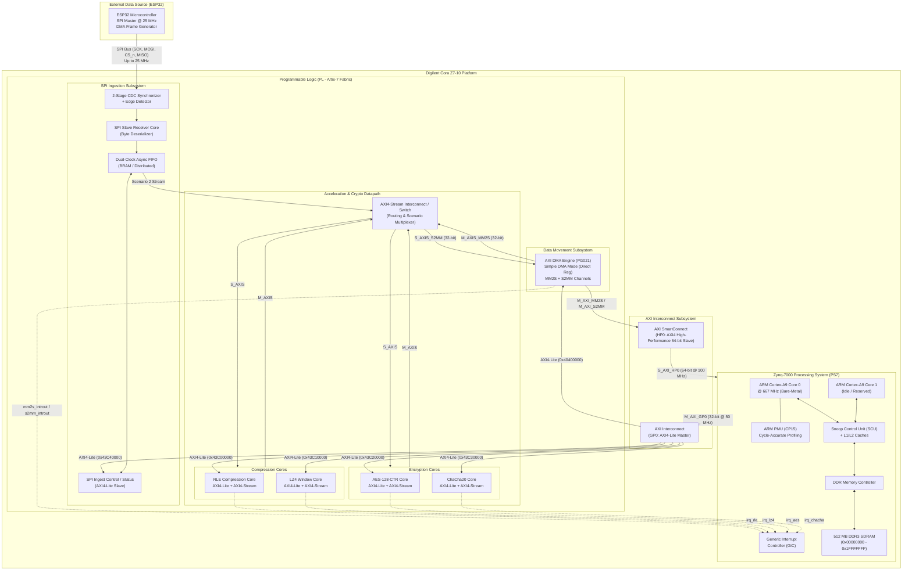
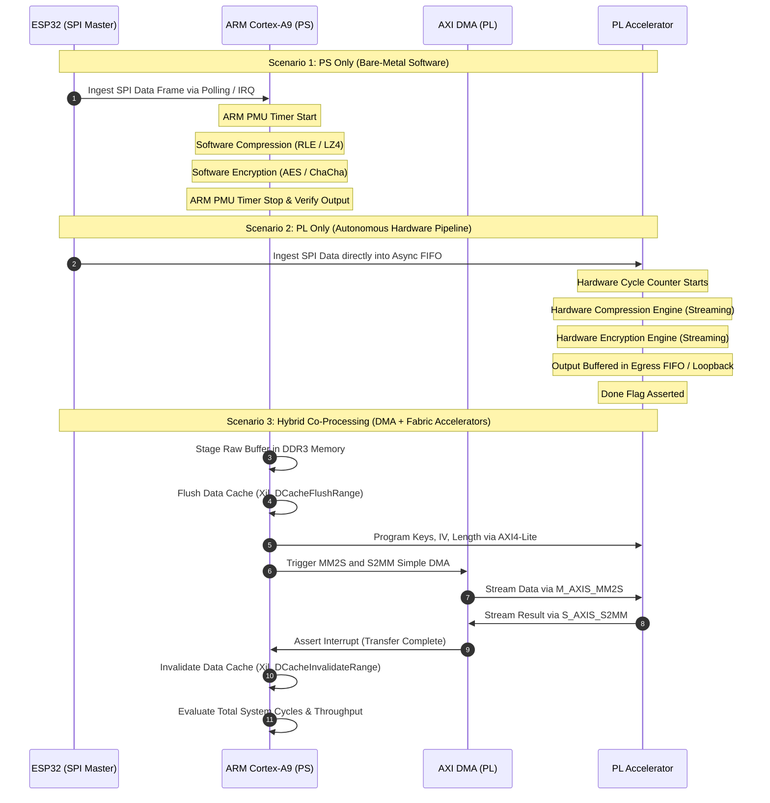
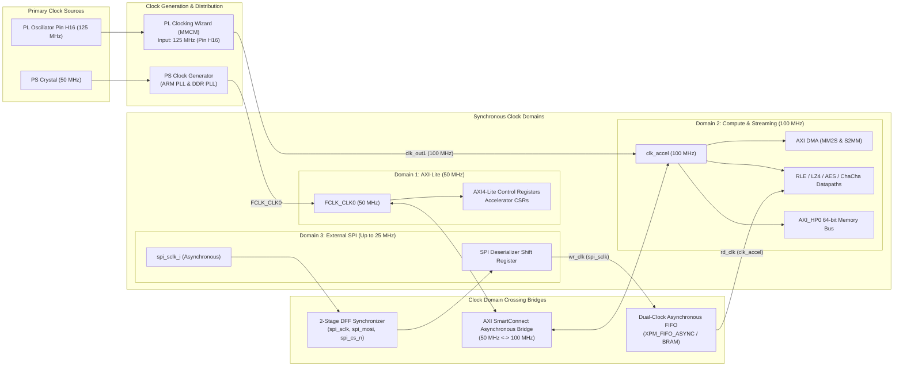

# System Architecture Specification: Heterogeneous Co-Design on Zynq-7010

This document establishes the authoritative system-level architectural specification for the heterogeneous co-design platform on the Digilent Cora Z7-10 (Xilinx Zynq-7010, `xc7z010clg400-1`). It defines the hardware/software partitioning, bus interconnect topologies, execution scenarios, clock/reset domain architecture, and development toolchain methodologies.

---

## 1. System Overview and Objectives

The platform evaluates and compares hardware/software co-design tradeoffs across two computational stages:
1. **Lossless Data Compression**: Run-Length Encoding (RLE) and a streamlined variant of LZ4 (LZSS-style byte sliding window).
2. **Symmetric Cryptography**: Advanced Encryption Standard in Counter Mode (AES-128-CTR) and the ChaCha20 stream cipher (RFC 8439).

### Primary Engineering Objectives
- **Three Architectural Scenarios**:
  - **Scenario 1 (PS Only)**: Pure software execution on the ARM Cortex-A9 processor.
  - **Scenario 2 (PL Only)**: Dedicated autonomous hardware pipeline in the Artix-7 FPGA fabric.
  - **Scenario 3 (Hybrid)**: Cooperative acceleration combining PS control, DDR3 buffering, AXI DMA data movement, and PL stream accelerators.
- **External Data Ingestion**:
  - High-speed synthetic ingestion from an external ESP32 microcontroller over a 4-wire SPI slave bus running at clock speeds up to 25 MHz.
- **Cycle-Accurate Benchmarking**:
  - Measurement of execution latency, processing throughput (MB/s), CPU cycles via the ARM Performance Monitor Unit (PMU), and FPGA resource utilization (LUTs, FFs, BRAMs, DSPs).

---

## 2. Global SoC Top-Level Architecture

The system takes full advantage of the Xilinx Zynq-7000 Extensible Processing Platform architecture, splitting responsibilities between the Processing System (PS) and Programmable Logic (PL).



### 2.1 Processing System (PS7) Configuration
- **Processor Core**: ARM Cortex-A9 MPCore running in single-core bare-metal configuration on Core 0 @ 667 MHz (Core 1 held in reset/WFE to eliminate cache coherency interference).
- **L1 Cache**: 32 KB 4-way associative instruction cache + 32 KB 4-way associative write-back data cache per core.
- **L2 Cache**: 512 KB unified 8-way associative cache managed by the Snoop Control Unit (SCU).
- **System Memory**: 512 MB DDR3 SDRAM (`MT41K256M16RE-125` equivalent) with a 16-bit physical bus clocked @ 525 MHz (1050 Mbps data rate).
- **Performance Monitor Unit (PMU)**: Direct access through ARM `CP15` coprocessor registers (`PMCCNTR`, `PMCR`, `PMCNTENSET`) providing zero-latency cycle counting.
- **General Interrupt Controller (GIC)**: Accepts up to 16 Fabric-to-PS interrupt signals (`IRQ_F2P[15:0]`).

### 2.2 PL Fabric Resources & Budgeting
The XC7Z010 device hosts 28,000 Logic Cells. Resource budgeting targets a maximum safe utilization of 85% to ensure timing closure:
- **6-Input LUTs**: Total 17,600 (Budget <= 14,900).
- **Flip-Flops**: Total 35,200 (Budget <= 29,900).
- **Block RAMs (36 Kb)**: Total 60 blocks (Budget <= 50 blocks).
- **DSP48E1 Slices**: Total 80 slices (Used primarily for address calculation and ChaCha20 additions if synthesized to DSP).

---

## 3. Operational Execution Scenarios

The architecture supports three distinct execution scenarios designed for comparative evaluation.



### 3.1 Scenario 1: PS Only (Bare-Metal Cortex-A9)
- **Execution Model**: All compression and encryption algorithms run entirely in C11 compiled with `-O2` targeting the ARM Cortex-A9.
- **Data Movement**: The SPI slave core captures incoming frames and stores them in a PL FIFO. The Cortex-A9 reads the FIFO over AXI4-Lite or general memory-mapped interface into a DDR3 staging buffer.
- **Profiling**:
  - Cycle count: Read via `CP15` cycle counter directly before and after the algorithm invocation.
  - Throughput: Calculated as $\text{Throughput} = \frac{\text{Block Size (Bytes)}}{\Delta \text{Cycles} \times \frac{1}{667 \text{ MHz}}}$.
  - Baseline: Represents standard embedded CPU processing without hardware offloading.

### 3.2 Scenario 2: PL Only (Dedicated Hardware Pipeline)
- **Execution Model**: The entire processing chain is realized in synthesizable VHDL-2008 RTL.
- **Data Movement**: Incoming SPI bytes pass from the CDC synchronizer into an asynchronous FIFO. The FIFO egress feeds an internal AXI4-Stream pipeline (`TDATA[7:0]` or `TDATA[31:0]`). The stream flows through the compression core, into an intermediate FIFO, through the encryption core, and terminates in an egress buffer.
- **CPU Intervention**: Zero CPU intervention during the data processing phase. The PS only configures initial key/parameters via AXI4-Lite during boot, or the keys are statically hardwired.
- **Profiling**: Internal hardware cycle counter increments while `BUSY` is asserted.

### 3.3 Scenario 3: Hybrid Co-Processing (AXI DMA + PL Streaming)
- **Execution Model**: The Processing System acts as the high-level orchestrator, buffer manager, and protocol parser, while offloading computation-intensive compression and cryptography to the PL.
- **Data Movement**:
  1. ARM CPU initializes input buffers in uncached or cache-flushed DDR3 memory.
  2. ARM CPU configures accelerator registers over `AXI_GP0` (AXI4-Lite).
  3. ARM CPU programs the AXI DMA engine in Simple Register Mode by writing source address, destination address, and byte lengths.
  4. AXI DMA reads DDR3 via `AXI_HP0` (64-bit burst) and drives `M_AXIS_MM2S`.
  5. The PL Accelerator consumes `M_AXIS_MM2S` and produces `S_AXIS_S2MM`.
  6. AXI DMA writes the processed stream back into DDR3 via `AXI_HP0`.
  7. AXI DMA asserts completion interrupts (`s2mm_introut`) to the ARM GIC.
- **Profiling**: Captures end-to-end latency including cache maintenance (`Xil_DCacheFlushRange` / `Xil_DCacheInvalidateRange`), DMA setup overhead, bus latency, and accelerator throughput.

---

## 4. Clock, Reset, and Domain Partitioning

Heterogeneous systems require rigorous isolation between asynchronous clock domains to eliminate metastability and timing violations.



### 4.1 Clock Domains & Distribution
1. **`Domain 1 (FCLK_CLK0)` - 50 MHz**:
   - Generated by the PS internal PLL and routed to PL via global clock buffer (`BUFG`).
   - Clock for `M_AXI_GP0` interconnect and all AXI4-Lite control/status register interfaces.
   - Low-frequency domain simplifies register timing closure.
2. **`Domain 2 (clk_accel)` - 100 MHz**:
   - Generated by an on-chip Mixed-Mode Clock Manager (`MMCME2_BASE`) inside the PL, referenced from the Cora Z7-10 125 MHz crystal on pin `H16`.
   - Drives the AXI DMA engine, the `S_AXI_HP0` memory bus, and the wide streaming computation datapaths of all four accelerators.
3. **`Domain 3 (spi_sclk_i)` - Asynchronous (Up to 25 MHz)**:
   - External clock generated by the ESP32 SPI master.
   - Completely asynchronous to `FCLK_CLK0` and `clk_accel`.

### 4.2 Reset Tree Architecture
- **Master Reset**: Driven by the PS `FCLK_RESET0_N` signal (active low).
- **Synchronous Reset Deassertion**: Each clock domain instantiates an explicit reset bridge (`xpm_cdc_async_rst` or equivalent 2-stage flip-flop chain) ensuring reset is asserted asynchronously but deasserted synchronously with the rising edge of that domain's clock.
- **Peripheral Soft Resets**: The `CONTROL` register of each PL accelerator exposes a `RESET_CORE` bit (Bit 1) enabling software-triggered synchronous resets of the datapath without resetting the AXI-Lite register interface.

### 4.3 Clock Domain Crossing (CDC) Protection
1. **SPI Input Signals (`spi_sclk_i`, `spi_mosi_i`, `spi_cs_n_i`)**:
   - External pin transitions pass through two back-to-back registers in the fast sampling domain to prevent metastability propagation.
   - A digital edge detector identifies falling and rising edges of `spi_sclk_i`.
2. **Data Streaming FIFO**:
   - Packets deserialized in the SPI clock domain are written into a dual-clock asynchronous FIFO (`xpm_fifo_async`).
   - The read side operates in the `clk_accel` domain, providing safe, jitter-tolerant data buffering.
3. **AXI Interconnect Bridges**:
   - The Xilinx AXI SmartConnect handles asynchronous clock conversion between the 50 MHz `AXI_GP0` and the 100 MHz `clk_accel` domain automatically with internal handshake synchronizers.

---

## 5. AXI Interconnect and DMA Subsystem

High-throughput data transfers in Scenario 3 rely on the Xilinx AXI Direct Memory Access (AXI DMA, PG021) core.

### 5.1 AXI DMA Configuration (Simple DMA Mode)
- **Mode Selection**: Simple Register Direct Mode (Non-Scatter-Gather).
  - *Rationale*: Eliminates BRAM descriptor fetching overhead, reduces PL resource usage by ~450 LUTs, and simplifies bare-metal driver maintenance.
- **MM2S (Memory-Mapped to Stream - Read Channel)**:
  - Memory-mapped interface: 64-bit AXI4 Full connected to `S_AXI_HP0`.
  - Stream interface: 32-bit AXI4-Stream (`M_AXIS_MM2S`).
  - Read burst size: 16 beats (data packing handled inside DMA).
- **S2MM (Stream to Memory-Mapped - Write Channel)**:
  - Stream interface: 32-bit AXI4-Stream (`S_AXIS_S2MM`).
  - Memory-mapped interface: 64-bit AXI4 Full connected to `S_AXI_HP0`.
  - Write burst size: 16 beats.

### 5.2 Cache Coherency Management Protocol
Because the Cortex-A9 uses write-back L1/L2 caches and `AXI_HP0` connects directly to the DDR memory controller without passing through the Snoop Control Unit (SCU), software must enforce explicit cache coherency:
1. **Prior to Transmit (MM2S)**:
   ```c
   Xil_DCacheFlushRange((INTPTR)tx_buffer, buffer_length);
   ```
   Flushes modified data from L1/L2 caches out to physical DDR3 so the DMA reads valid data.
2. **Prior to / After Receive (S2MM)**:
   ```c
   Xil_DCacheInvalidateRange((INTPTR)rx_buffer, buffer_length);
   ```
   Invalidates cached lines in L1/L2 so the CPU reads fresh data written by the DMA rather than stale cache lines.
3. **Buffer Alignment**:
   All DMA buffers must be 32-byte aligned to match the L1 cache line size, preventing cache corruption of adjacent variables:
   ```c
   static uint8_t tx_buffer[MAX_BLOCK_SIZE] __attribute__((aligned(32)));
   static uint8_t rx_buffer[MAX_BLOCK_SIZE] __attribute__((aligned(32)));
   ```

---

## 6. Development & Tooling Strategy

The repository follows a strict script-first, reproducible development methodology across all three software suites.

### 6.1 Vivado 2026.1 Batch Automation Flow
All FPGA development is driven non-interactively using Vivado batch Tcl scripts located in `cora7z/app/hw/scripts/`.

| Script | Purpose |
|---|---|
| `create_project.tcl` | Recreates the Vivado project, configures the PS7 preset for Cora Z7-10, instantiates AXI DMA, Clocking Wizard, and accelerator IPs. |
| `bd.tcl` | Builds the Block Design interconnect graph and exports the top-level VHDL wrapper. |
| `build.tcl` | Runs synthesis (`synth_1`), implementation (`impl_1`), timing closure validation, and generates the bitstream. |
| `export_xsa.tcl` | Exports the fixed hardware platform container `cora7z/app/hw/vivado/cora7z_top.xsa` including bitstream. |
| `reports.tcl` | Dumps timing (`report_timing_summary`), DRC, and utilization reports into `out/vivado_reports/`. |

- **Execution Command**:
  ```bash
  source .agents/env.sh
  cd cora7z/app/hw/vivado
  vivado -mode batch -notrace -source ../scripts/build.tcl
  ```

### 6.2 Vitis 2026.1 Unified Python / CMake Flow
Vitis 2026.1 replaces the legacy XSCT tool with a modern, unified Python client interface:
- **Automation Script**: `cora7z/app/sw/scripts/build_sw.py`
  - Creates the standalone platform component from `cora7z_top.xsa`.
  - Configures the board support package (BSP) with standard drivers (`xil_io`, `xaxidma`).
  - Creates and builds the bare-metal C application targeting `ps7_cortexa9_0`.
- **Compiler Rules**:
  - GCC for ARM (`arm-none-eabi-gcc`).
  - Strict compilation flags: `-Wall -Wextra -Werror -O2 -std=c11`.
  - Zero dynamic memory allocation (`malloc`/`free` strictly forbidden).
- **Execution Command**:
  ```bash
  source .agents/env.sh
  vitis -s cora7z/app/sw/scripts/build_sw.py
  ```

### 6.3 ESP-IDF External Ingestion Setup (ESP32)
The external data injector runs on an ESP32 microcontroller configured as an SPI master:
- **Toolchain**: ESP-IDF v5.x with VS Code extension integration under `esp32/`.
- **SPI Driver Configuration**:
  - Uses `SPI2_HOST` (HSPI) with hardware DMA enabled (`SPI_DMA_CH_AUTO`).
  - Transmission clock configured up to 25 MHz (Mode 0: CPOL=0, CPHA=0).
- **Payload Synthesis Modes**:
  1. *Repetitive Pattern*: Highly compressible test vectors (e.g., continuous strings of identical bytes) to stress RLE and LZ4 compression.
  2. *Pseudo-Random Pattern*: Linear Feedback Shift Register (LFSR) data with high Shannon entropy ($H(X) \approx 8$ bits/byte) to verify compression rejection and crypto throughput.
  3. *Telemetry Frames*: Structured sensor-like frames mixing ASCII headers, timestamps, and floating-point readings.

---

## 7. Deliverable Verification Matrix

The architectural artifacts defined in this document directly fulfill the requirements of Phase 1:

| Architectural Requirement | Verification Mechanism | Status / Target |
|---|---|---|
| Complete Top-Level Block Diagram | Mermaid diagram in Section 2 | Verified in Document |
| Three Execution Scenarios Defined | Sequence diagram & analysis in Section 3 | Verified in Document |
| Clock & CDC Strategy Specified | Dual-clock FIFO + synchronizer schema in Section 4 | Verified in Document |
| AXI DMA Architecture Finalized | Simple Mode + Cache Coherency protocol in Section 5 | Verified in Document |
| Hardware Register Map Locked | Cross-checked with `INTERFACES.md` | `address-map-check.py` PASS |
| Scripted Tooling Defined | Vivado Tcl, Vitis Python, ESP-IDF in Section 6 | Aligned with Skills |
