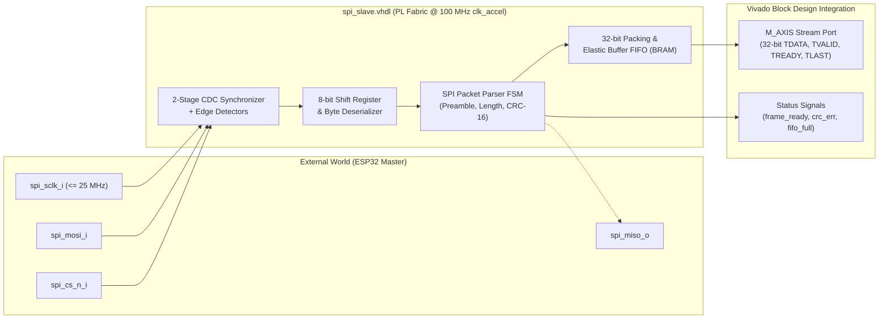

# Task 2.1: Receptor SPI Escravo com Buffer FIFO/BRAM

## 1. Task Overview & Metadata

- **Task ID**: `2.1`
- **Phase**: `2` (Modelagem RTL e Testbenches em VHDL)
- **Title**: Receptor SPI escravo com buffer FIFO/BRAM
- **Associated Deliverable**: Fontes VHDL (`cora7z/app/hw/src/spi_slave.vhdl`) e Testbench VUnit (`cora7z/app/hw/test/tb_spi_slave.vhdl`)
- **Estimated Duration**: 4 days
- **Dependencies**: Task 1.3 (Completed - Architecture & Interface Specification)
- **Status**: Pendente -> Em andamento

---

## 2. Architectural Role & Reuse Strategy

The SPI Slave module is the **universal data ingestion frontend** for the entire project. It will be reused across all experimental scenarios:
- **Scenario 1 (PS Only)**: Buffers synthetic frames from the ESP32 into a local FIFO where the Cortex-A9 can read them over AXI4-Lite into DDR3.
- **Scenario 2 (PL Only)**: Streams deserialized bytes directly into the compression (RLE/LZ4) and encryption (AES/ChaCha20) pipelines via AXI4-Stream.
- **Scenario 3 (Hybrid Co-Processing)**: Directly interfaces with AXI DMA (S2MM channel) or an intermediate AXI-Stream FIFO connected to the Vivado Block Design.

By designing `spi_slave` with an **AXI4-Stream master port** (`m_axis_tdata[31:0]`, `m_axis_tvalid`, `m_axis_tready`, `m_axis_tlast`, `m_axis_tkeep[3:0]`), it can be directly instantiated in the Vivado Block Design as an **RTL Module Reference** and connected cleanly to Xilinx IP cores (AXI DMA, AXI-Stream FIFO, AXI SmartConnect).



---

## 3. CLI Development Plan (AI Assistant)

The AI executes all VHDL RTL authoring, self-checking VUnit testbench creation, static linting, and simulation in the CLI:

### 3.1 Entity Specification (`cora7z/app/hw/src/spi_slave.vhdl`)
- **File**: `cora7z/app/hw/src/spi_slave.vhdl`
- **Entity Name**: `spi_slave`
- **Language**: VHDL-2008 (`ieee.std_logic_1164`, `ieee.numeric_std`).
- **Generics**:
  - `g_fifo_depth` : natural := 2048 (Depth of internal packet FIFO in bytes).
  - `g_sclk_filter_depth` : natural := 2 (Number of synchronizer sampling stages).
- **Port Interface**:

| Port Name | Direction | Type | Clock Domain | Description |
|---|---|---|---|---|
| `clk_i` | In | `std_logic` | `clk_accel` (100 MHz) | System processing clock |
| `rst_n_i` | In | `std_logic` | `clk_accel` | Active-low synchronous reset |
| `spi_sclk_i` | In | `std_logic` | Asynchronous (SPI) | Serial clock from ESP32 (Mode 0) |
| `spi_mosi_i` | In | `std_logic` | Asynchronous (SPI) | Serial data from ESP32 |
| `spi_miso_o` | Out | `std_logic` | Synchronous to `clk_i` | Serial data to ESP32 (loopback / status) |
| `spi_cs_n_i` | In | `std_logic` | Asynchronous (SPI) | Active-low frame chip select |
| `m_axis_tdata_o` | Out | `std_logic_vector(31 downto 0)` | `clk_i` | 32-bit packed AXI-Stream data |
| `m_axis_tvalid_o` | Out | `std_logic` | `clk_i` | Stream valid handshake |
| `m_axis_tready_i` | In | `std_logic` | `clk_i` | Stream ready backpressure |
| `m_axis_tlast_o` | Out | `std_logic` | `clk_i` | End-of-packet boundary flag |
| `m_axis_tkeep_o` | Out | `std_logic_vector(3 downto 0)` | `clk_i` | Byte qualifiers for final word |
| `frame_ready_o` | Out | `std_logic` | `clk_i` | Pulse asserted when frame passes CRC |
| `crc_error_o` | Out | `std_logic` | `clk_i` | Pulse asserted if CRC-16 check fails |
| `fifo_overflow_o` | Out | `std_logic` | `clk_i` | Flag asserted if FIFO overflows |

### 3.2 VUnit Testbench (`cora7z/app/hw/test/tb_spi_slave.vhdl`)
The testbench validates the core against high-speed serial stimuli:
1. `test_reset_state`: Confirms FIFO is empty and stream signals are deasserted after reset.
2. `test_single_packet_25mhz`: Transmits a complete valid frame at 25 MHz SPI clock (Preamble `0xAA55`, Type `0x01`, Flags `0x03`, Length 64 bytes, sequential payload, CRC-16). Verifies 32-bit streaming reconstruction.
3. `test_backpressure`: Transmits frame while holding `m_axis_tready_i = '0'` for several cycles to verify elastic FIFO buffering without data corruption.
4. `test_invalid_preamble`: Transmits frame with header `0x55AA`; verifies frame is discarded.
5. `test_corrupted_crc`: Transmits frame with inverted CRC-16; verifies `crc_error_o` pulses and frame is dropped.

### 3.3 CLI Verification Commands
```bash
# 1. Run VUnit self-checking testbench
make -C cora7z/app/hw test TB=tb_spi_slave

# 2. Run static VHDL lint gate
TASK_ID=2.1 bash .agents/hooks/vhdl-lint.sh

# 3. Run simulation gate
TASK_ID=2.1 bash .agents/hooks/vhdl-sim-gate.sh
```

---

## 4. Vivado GUI Development Plan (User Guide)

When integrating `spi_slave` into the Vivado Block Design (following the methodology from `~/ufmg/soc/exercises/slides/corez7`):

### 4.1 Step-by-Step Block Design Integration
1. **Open Vivado GUI**:
   - Open Vivado and load the project: `cora7z/app/hw/vivado/cora7z_top.xpr` (or create via `create_project.tcl`).
2. **Add Source to Project**:
   - In Vivado GUI, click **Add Sources** -> **Add or create design sources** -> select `cora7z/app/hw/src/spi_slave.vhdl`.
3. **Instantiate in Block Design**:
   - Open your Block Design (`cora7z_top.bd`).
   - Right-click anywhere on the canvas -> **Add Module...** -> choose `spi_slave`.
   - Vivado instantiates `spi_slave_0` as an RTL Module Reference.
4. **Connect Clocks & Resets**:
   - Connect `clk_i` to the 100 MHz clock source (`clk_out1` of `clk_wiz_0` or `FCLK_CLK0` if 100 MHz).
   - Connect `rst_n_i` to `peripheral_aresetn` from `rst_ps7_0_100M`.
5. **Route External SPI Pins**:
   - Right-click on pins `spi_sclk_i`, `spi_mosi_i`, `spi_miso_o`, and `spi_cs_n_i` -> **Make External**.
   - Rename external ports to `spi_sclk_i`, `spi_mosi_i`, `spi_miso_o`, and `spi_cs_n_i`.
6. **Connect AXI-Stream Datapath**:
   - Connect `m_axis` interface to the AXI-Stream Interconnect, AXI DMA `S_AXIS_S2MM`, or internal FIFO.
7. **Validate & Save**:
   - Click **Validate Design** (`F6` or `validate_bd_design`).

### 4.2 Tcl Console Shortcuts (Copy & Paste in Vivado)
For users who prefer running quick Tcl commands in Vivado's Tcl Console:
```tcl
# Add RTL module reference to current BD
create_bd_cell -type module -reference spi_slave spi_slave_0

# Connect clocks and resets
connect_bd_net [get_bd_pins clk_wiz_0/clk_out1] [get_bd_pins spi_slave_0/clk_i]
connect_bd_net [get_bd_pins rst_clk_wiz_0_100M/peripheral_aresetn] [get_bd_pins spi_slave_0/rst_n_i]

# Export SPI physical pins
make_bd_pins_external  [get_bd_pins spi_slave_0/spi_sclk_i]
make_bd_pins_external  [get_bd_pins spi_slave_0/spi_mosi_i]
make_bd_pins_external  [get_bd_pins spi_slave_0/spi_miso_o]
make_bd_pins_external  [get_bd_pins spi_slave_0/spi_cs_n_i]

# Regenerate visual layout
regenerate_bd_layout
validate_bd_design
```

### 4.3 Physical Constraints (XDC)
Ensure the following lines are present in `cora7z/app/hw/utils/pins.xdc`:
```xdc
# External SPI Bus (ChipKIT / Arduino Shield Header J1)
set_property -dict { PACKAGE_PIN G20   IOSTANDARD LVCMOS33 } [get_ports { spi_sclk_i }]; # SCK
set_property -dict { PACKAGE_PIN T10   IOSTANDARD LVCMOS33 } [get_ports { spi_mosi_i }]; # MOSI
set_property -dict { PACKAGE_PIN V15   IOSTANDARD LVCMOS33 } [get_ports { spi_miso_o }]; # MISO
set_property -dict { PACKAGE_PIN F16   IOSTANDARD LVCMOS33 } [get_ports { spi_cs_n_i }]; # CS_n
```

---

## 5. Acceptance Criteria & Quality Gates

To mark Task 2.1 as `Concluída`:
1. `cora7z/app/hw/src/spi_slave.vhdl` passes static analysis with zero warnings (`TASK_ID=2.1 bash .agents/hooks/vhdl-lint.sh`).
2. `cora7z/app/hw/test/tb_spi_slave.vhdl` passes all test cases in VUnit (`make -C cora7z/app/hw test TB=tb_spi_slave`).
3. Gate evidence recorded in `out/gates/2.1_vhdl-sim_PASS.json`.
4. Vivado Block Design accepts `spi_slave` as a valid RTL Module Reference without synthesis DRC errors.
5. Task handoff documented in `utils/memory/handoff/2.1.md`.
